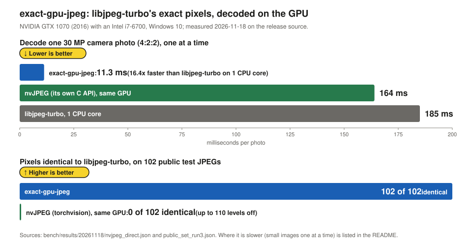

# exact-gpu-jpeg

**A JPEG codec for NVIDIA GPUs whose output is identical to the CPU libraries': decoded pixels equal
libjpeg-turbo's and encoded files equal Pillow's (libjpeg-turbo), byte for byte.** Every number and every test
result here is from one PC, a GTX 1070 on Windows 10; the library has not been run on Linux or on newer cards.



**Tested hard.** 120,000 fuzzed inputs without a crash or hang. 2,250 test files, 1,259 of them real camera and phone
photos (Sony ILCE-7M4, 7M3 and 6300, iPhone X and 7 among them): every one it decoded on the GPU was byte-identical
to libjpeg-turbo, and the rest were declined to the CPU decoder. On a public set, imagecompression.info's 8-bit test
images (14 photos) and libjpeg-turbo's three benchmark frames, 17 images at 6 settings each: 102 of 102 decodes
identical to libjpeg-turbo, all on the GPU, and 68 of 68 comparable encodes byte-identical to Pillow's. The images
are downloaded by `bench/public_set.py`, which checks the two archives' SHA-256 and makes every JPEG in memory; no
image is in the repository.
<!-- numbers: bench/results/fuzz/summary_20261118.json; bench/results/exactness.json; public set: bench/results/20261118/public_set_run3.json (summary) -->

**What "identical" covers.** Decoding: 8-bit baseline and extended-sequential Huffman JPEGs with one scan,
grayscale or YCbCr, 4:4:4, 4:2:2, 4:2:0, 4:4:0, 4:1:1 and other integral sampling factors, with or without restart
markers, any valid Huffman tables. Encoding: RGB uint8 images, quality 1–100, 4:4:4 / 4:2:2 / 4:2:0, with or
without an ICC profile and EXIF. A file the GPU path declines (progressive and the rest in [the claim](#the-claim))
is decoded by the CPU decoder, the reference library itself, so the pixels are still identical. A file
libjpeg-turbo decodes only with a warning is declined by default, by both routes; `strict=False` gives
libjpeg-turbo's image and names the warning. A file libjpeg-turbo rejects is rejected by both routes. CMYK and YCCK
files are outside the claim (the CPU decoder converts them to RGB itself). The bytes are libjpeg-turbo's as built
for x86-64; not checked: other libjpeg-turbo versions, ARM64 (NEON) builds, other Pillow versions.

**Other decoders, measured.** On the 102 public-set JPEGs, against libjpeg-turbo with the accurate IDCT and fancy
upsampling: nvJPEG (through torchvision at its defaults, on the same GPU) was identical on 0 of 102 and differed by
up to 110 levels at 4:2:0, within 4 at 4:4:4 and within 1 for gray. Pillow, OpenCV, torchvision on the CPU and
libvips gave libjpeg-turbo's pixels on 102 of 102.
<!-- numbers: bench/results/20261118/public_set_run3.json (summary) -->

**1. The same bytes.** Identical bytes mean:

- JPEG work moves to the GPU without changing any result, so existing tests, caches and file hashes keep working;
- a model sees the same pixels in training and in production, whichever machine decoded them;
- a file the GPU declines (progressive, for example) is decoded on the CPU instead, and nobody can tell which path
  ran.

**2. Fast on ordinary GPUs.** For baseline JPEGs, one image at a time from about 0.5 MP up and in batches at every
size measured, it is the fastest JPEG decoder we have measured on this GPU, which has no hardware JPEG engine. The
whole decode runs on the GPU, including the Huffman stage that most decoders leave on the CPU. On a GTX 1070:

- **16× faster decoding** than libjpeg-turbo on one CPU core: a 30 MP camera photo in 11.3 ms instead of 185 ms
  (nvJPEG on the same card: 164 ms). Against all eight CPU threads: 93 of these photos a second with two GPU
  threads, against 24.
- **Batches of small images:** pass a list and they are decoded together: 7,310 images a second at 0.25 MP and 1,881
  at 2 MP, 2.4 to 4.7× all eight CPU threads running libjpeg-turbo and 4.7 to 7.2× nvJPEG at its fastest.
- **Straight into your model:** decode to a normalised float16 CHW tensor in one pass, 1.9× faster than decoding and
  then converting (14.2 ms against 26.9 ms on 30 MP photos), with the same bits.
- **5.5× faster encoding** than Pillow, with the same bytes: a photo's three web exports (3840×2560, 1500×1000 and
  1200×800) from a NumPy array in 19.4 ms instead of 107 ms. When the pixels are already on the GPU (decode, edit,
  encode), 7.0 ms.
- **On the public set**, one image at a time, it was faster than both libjpeg-turbo on one thread and nvJPEG on all
  102 JPEGs: a median of 12.5× and 10.7×. The closest case is a rendered frame at 4:2:0, at 1.22× libjpeg-turbo.
<!-- numbers: bench/results/20261118/nvjpeg_direct.json (camera photo one at a time, batches); bench/results/20261118/bench.json (eight CPU threads, two GPU threads); bench/results/20261118/epilogue.json; bench/results/20261118/encode.json (the three sizes' pillow_ms, gpu_from_host_ms and gpu_ms, summed); bench/results/20261118/public_set_run3.json -->

**3. Decoding the same photo again: UnHuff.** *UnHuff: a Huffman-free coefficient format for exact repeat JPEG decodes.* A viewer, a preview or a culling pass often decodes
the same file several times. `RepeatCache` keeps an UnHuff copy of a file in GPU memory, its decoded coefficients
packed with no Huffman coding, so a later
decode of that file skips the entropy decode, the slowest step. The pixels are the same as a fresh decode's.

```python
import exact_gpu_jpeg as egj

cache = egj.RepeatCache()
img = egj.decode("photo.jpg", cache=cache, check="light")    # a viewer, a preview, a culling pass
```

How much it saves depends on how the copy is checked against the file:

- **`check="light"`** compares the file's size, modification time and first 64 KiB with the last full read. On the
  12 camera photos (30 MP) a decode from the copy took 4.1 ms against 13.1 ms for a normal decode, about 3× faster.
  On the 14 public-set photos it took 1.4 ms against 4.2 ms. It misses a file rewritten past its first 64 KiB with
  its size and modification time kept, so it suits viewers, previews and culling, not files rewritten in place.
- **`check="full"`**, the default, reads the whole file and compares its full identity. On this PC that costs more
  than it saves: 18.3 ms against 13.1 ms for a normal decode of a 30 MP photo, and 5.5 ms against 4.2 ms on the public
  set. With the full check, the cache paid only below about 2 MP.

The copy costs GPU memory: 2.7 to 2.8 times the JPEG's size, from 0.1 to 24 MP. A cache holds up to 1 GB of copies
by default (`memory_bytes`) and drops the least recently used. Without a `RepeatCache` nothing about a file is kept.
When and why it pays, and what it guarantees: [Decode the same file again](docs/repeat.md).
<!-- numbers: bench/results/20261118/repeat_paths.json (medians of 7 rounds of 5 calls, from a path, the result on the GPU); bench/results/20261118/repeat_sizes.json (the 2 MP crossing); bench/results/20261118/copy_forms.json (bytes: packed / jpeg) -->

**Where it loses, or is unproven.**

- **One small image at a time.** At 0.25 MP one call per image does 887 images a second, against 1,122 for
  libjpeg-turbo on one thread and 947 for nvJPEG. Pass a list: in batches the same images are 7,310 a second.
- **The CPU route for one small image.** Below a size measured once on each machine (`cpu_below`), `decode`
  decodes on the CPU and uploads, which is faster for the smallest images: 0.37 ms against 1.01 ms on the GPU at
  0.02 MP. The measurement varies from run to run and does not yet take the subsampling into account. Two fresh
  measurements on this PC gave 166,294 and 259,010 pixels. With the higher one, a 0.25 MP 4:2:0 image took 1.36 ms
  on the CPU route against 1.11 ms on the GPU. At 4:4:4 the CPU route was slower from 0.1 MP: 1.38 ms against
  0.85 ms at 0.2 MP. `cpu_below=0` always uses the GPU ([Small images](docs/small-images.md)).
- **Small encodes against all eight CPU threads.** At 1200x800, simplejpeg on eight threads encodes 1,305 images a
  second, against 1,049 for this library from GPU memory and 567 from host memory. From host memory it is also
  slower at 1500x1000 (378 against 482). One image at a time it is faster than both CPU encoders at every size.
- **After a pause.** The figures here are for a busy GPU. After five to ten seconds of idleness the card may drop to
  a lower clock: a 24 MP decode then took 16 to 18 ms instead of about 6, in 1 of 8 tries after 5 s and 1 of 6
  after 10 s. After a quarter of a second, a small decode took 1.34 ms against 0.96 ms in a loop
  ([An idle GPU](docs/first-call.md)).
- **Progressive files** go to the CPU decoder, so they cost libjpeg-turbo's decode plus the upload: slower than
  libjpeg-turbo alone (338 to 400 ms against 288 to 358 ms for 8K files). nvJPEG decodes them on the GPU, faster,
  with different pixels.
- **Cards with a hardware JPEG engine** (A100 class): nvJPEG may well be faster there. Not measured.
<!-- numbers: bench/results/20261118/nvjpeg_direct.json (one at a time, batches); bench/results/20261118/encode.json; bench/results/20261118/idle_gpu.json; bench/results/20261118/public_files.json (progressive); bench/results/20261118/small_image.json (CPU route: medians of 8, limit_at_start 259,010) and bench/results/20261118/reproduce.conditions.json (cpu_below_before_run 166,294) -->

Measured on one PC: an NVIDIA GTX 1070 (2016, 8 GB) and an Intel i7-6700, on Windows 10.

### Against nvJPEG and libjpeg-turbo, on a GTX 1070

**One image at a time** (images per second; each call decodes one image and waits for it):

| | exact-gpu-jpeg | nvJPEG, own API | libjpeg-turbo, one thread | vs nvJPEG | vs libjpeg-turbo |
|---|---|---|---|---|---|
| one 30 MP camera photo (4:2:2) | **88.5** (11.3 ms) | 6.1 | 5.4 | **14.5× faster** | 16.4× faster |
| 2 MP (1736×1160, 4:2:0) | **548** | 178 | 130 | **3.1× faster** | 4.2× faster |
| 0.25 MP (616×408, 4:2:0) | 887 | 947 | **1,122** | 0.94× (slower) | 0.79× (slower) |

**Many images at once** (images per second; batches of 64 different JPEGs):

| | exact-gpu-jpeg, `decode_batch` | nvJPEG at its fastest (batched, GPU_HYBRID) | libjpeg-turbo, 8 threads | vs nvJPEG | vs libjpeg-turbo |
|---|---|---|---|---|---|
| 0.25 MP (616×408, 4:2:0) | **7,310** | 1,562 | 3,046 | **4.7× faster** | 2.4× faster |
| 2 MP (1736×1160, 4:2:0) | **1,881** | 288 | 440 | **6.5× faster** | 4.3× faster |
| 6 MP (3000×2000, 4:2:0) | **730** | 101 | 154 | **7.2× faster** | 4.7× faster |

| output | |
|---|---|
| exact-gpu-jpeg | byte-identical to libjpeg-turbo, on every image of both tables |
| nvJPEG | not identical on any image, whichever API and back end: up to 15 levels off on the camera photos (4:2:2), up to 38 to 50 in the size sets (4:2:0); mean differences 0.47 on the camera photos and 0.52 to 0.64 in the size sets; up to 110 on the 102 public-set JPEGs (4:2:0, through torchvision) |
<!-- numbers: bench/results/20261118/nvjpeg_direct.json (both tables and the output row); public set: bench/results/20261118/public_set_run3.json -->

One run on 2026-11-18 (`bench/nvjpeg_direct.py`), from the JPEG bytes in host memory to the decoded RGB image, file
reads not included. This GPU has no hardware JPEG engine, so nvJPEG runs its CUDA path here. Across the two
tables, one call per small image is slower than the others' batched routes up to 1 MP: that is what a list is
for. What was compared, and how: [Reproduce the benchmark](docs/benchmarks.md#against-nvjpeg-and-libjpeg-turbo).
nvJPEG's differences grow with chroma subsampling: on the public set it is within 4 levels at 4:4:4 and up to 110
at 4:2:0.

**nvJPEG's encoder, measured.** nvJPEG's encoder through `torchvision.io.encode_jpeg` on a CUDA tensor writes 4:4:4
at its defaults, so it was compared at quality 95, 4:4:4, on the 17 public-set images, against libjpeg-turbo's
file at the same setting (which this library's encoder reproduces byte for byte). Its files were identical on 0 of
17. They were 95.8% to 99.9% of libjpeg-turbo's size and 0.02 to 3.47 dB lower in PSNR against the source image,
lower on every image (both files decoded with libjpeg-turbo). This is a measured statement about one setting: the
two encoders need not mean the same thing by "quality 95".
<!-- numbers: bench/results/20261118/public_set_run3.json (summary: nvjpeg_encode_q95_444) -->

**The public set.** `python bench/public_set.py out.json` repeats these checks and times on your own GPU: it downloads
imagecompression.info's 8-bit test images and libjpeg-turbo's three benchmark frames, checks the archives' SHA-256
and makes the 102 JPEGs in memory ([Reproduce the benchmark](docs/benchmarks.md#the-public-image-set)).

### The claim

| | decoding | encoding |
|---|---|---|
| equal to | **libjpeg-turbo 3.1.2** (as bundled in simplejpeg 1.9.0) with the accurate integer IDCT and fancy upsampling, in its AVX2, SSE2 and plain C code paths; Pillow 13.0.0 (libjpeg-turbo 3.2.0) gave the same images | **Pillow 13.0.0** (libjpeg-turbo 3.2.0) with its default settings |
| what is equal | every byte of the decoded pixels (RGB, BGR or GRAY) | every byte of the file: header, tables and compressed data |
| for | 8-bit baseline and extended-sequential Huffman JPEGs with one scan: grayscale or YCbCr; 4:4:4, 4:2:2, 4:2:0, 4:4:0, 4:1:1 and other integral sampling factors; with or without restart markers; any valid Huffman tables | RGB uint8 images, quality 1–100, 4:4:4 / 4:2:2 / 4:2:0, with or without an ICC profile and EXIF |
| declined, never approximated | progressive, arithmetic-coded, lossless, hierarchical, 12-bit, RGB-coded and multi-scan files, fractional sampling factors, and coefficients on which libjpeg-turbo's own code paths disagree. `decode()` then uses the CPU decoder (the reference library itself), so the caller still gets the reference pixels | everything Pillow's defaults do not write (optimised tables, progressive, restart markers, grayscale or CMYK input): not offered |
| files libjpeg-turbo warns about | no end marker or data that ends early, extraneous bytes before a marker, a JFIF version other than 1.x (before or after the scan), an unknown Adobe transform, a malformed ICC profile, any other libjpeg-turbo warning: declined by the GPU path, and the CPU decoder raises for them too, by default; `strict=False` gives libjpeg-turbo's image and names the warning | |
| rejected | a file libjpeg-turbo rejects is rejected by both routes | |
| outside the claim | CMYK and YCCK (four-component) files: decoded by the CPU decoder with its own colour conversion, because libjpeg-turbo has none to RGB; the reason says so | |
| not checked | other libjpeg-turbo versions; ARM64 (NEON) builds were not analysed: the bytes are libjpeg-turbo's as built for x86-64 (its C and SSE2/AVX2 code) | other Pillow versions |

`strict` is a keyword of `decode()`, `decode_batch()`, `decode_cpu()` and `Decoder`. Where the warning is reported, which warned files the GPU path itself decodes, and unused bytes at the end of the scan:
[The claim in one table](docs/exactness.md#the-claim-in-one-table). The evidence for each row, and how to check your
own files: [Check what "identical" means](docs/exactness.md).

## Install

```bash
git clone https://github.com/mrluker/exact-gpu-jpeg
cd exact-gpu-jpeg
pip install "cupy-cuda12x[ctk]"   # CuPy with the CUDA 12 runtime and NVRTC from pip
pip install -e .                  # from the checkout (with simplejpeg, the CPU decoder for the fallback)
```

Install from GitHub; not on PyPI yet. On a GPU older than Turing (a GTX 10-series card, for example) use the CUDA 12
packages as above: CUDA 13 dropped those GPUs. Requirements: [Install, decode, encode](docs/getting-started.md).

## Use

```python
import exact_gpu_jpeg as egj

img = egj.decode("photo.jpg")                    # CuPy uint8 (H, W, 3), RGB, on the GPU
imgs = egj.decode(["a.jpg", "b.jpg", data])      # a list: decoded together, a list of images
data = egj.encode(img, quality=90, subsampling="444", icc_profile=icc, exif=exif)   # bytes, as Pillow writes
```

## Documentation

- [Install, decode, encode](docs/getting-started.md): requirements, the pip lines, first decode and encode, `self_check()`.
- [Decode a JPEG to a GPU array](docs/decode.md): files and bytes, colour spaces, model inputs, torch tensors, declined files.
- [Encode a GPU image to a JPEG](docs/encode.md): bytes or a file, quality, subsampling, ICC and EXIF, the Pillow call it equals.
- [Decode many files in one call](docs/batches.md): lists, `decode_batch`, which files share a batch, memory.
- [Decode into your own GPU work](docs/pipelines.md): `decode_async`, `upload_ahead`, `encode_async` and `ready=`.
- [Check what "identical" means](docs/exactness.md): the claim, what is declined, the fast modes, checking your own files.
- [Small images and the CPU route](docs/small-images.md): `cpu_below`, the measured value, the settings file.
- [The first call, warm-up and an idle GPU](docs/first-call.md): what the first calls cost and where to pay it.
- [Run on a GPU it has never seen](docs/new-gpu.md): the device check, the self-check, `device_report()`.
- [Reproduce the benchmark](docs/benchmarks.md): `python bench/reproduce.py` and every benchmark table.
- [When something is wrong](docs/troubleshooting.md): symptom, cause and fix.
- [Who it is for](docs/use-cases.md): photo editors, culling, re-exports, image servers, training loops; and who not.
- [How it works, limits, what is not done](docs/how-it-works.md): the design, safety, limitations, prior work.
- [Every name, option and variable](docs/reference.md): the full reference.
- [White paper](docs/white-paper.md): the method, the evidence, every measurement and the limits, in one document.

## Tested configuration

The only one: Windows 10 (64-bit), an NVIDIA GTX 1070 (8 GB, compute capability 6.1)
with driver 560.94, Python 3.12, CuPy 14.2.0 with the CUDA 12.9 runtime packages from pip. A clean install was
checked on that PC: a new virtual environment, every package from downloaded wheels only, no CUDA Toolkit and no
CUDA environment variables, then the examples above, the test suite and `bench/reproduce.py`. That cannot show
how a different driver, GPU or operating system behaves: Linux, newer GPUs and CUDA 11 should work (nothing in the
kernels is specific to this card) but have not been run; see [Not done yet](docs/how-it-works.md#not-done-yet).

Status: version 0.1. Changes: [CHANGELOG.md](CHANGELOG.md).

## Credit

The Huffman stage is self-synchronising parallel decoding, the method of André Weißenberger and Bertil Schmidt
(ICPP 2018), going back to Shmuel T. Klein and Yair Wiseman (2003); this implementation was written from the papers.
The arithmetic is ported from libjpeg-turbo / the Independent JPEG Group's library. Full citations and what this
library adds: [Prior work and credit](docs/how-it-works.md#prior-work-and-credit).

## License

Copyright (c) 2026 Luke Riley. MIT for this project's code. Parts are ported from libjpeg-turbo and remain under the IJG License:
**this software is based in part on the work of the Independent JPEG Group.** See
[THIRD_PARTY_NOTICES.md](THIRD_PARTY_NOTICES.md) for what was ported and changed, and `licenses/` for the
libjpeg-turbo and IJG texts.

## In memory

This library is dedicated to the memory of Rudy Sepp, Enoch Carlson and Timothy Carlson.
