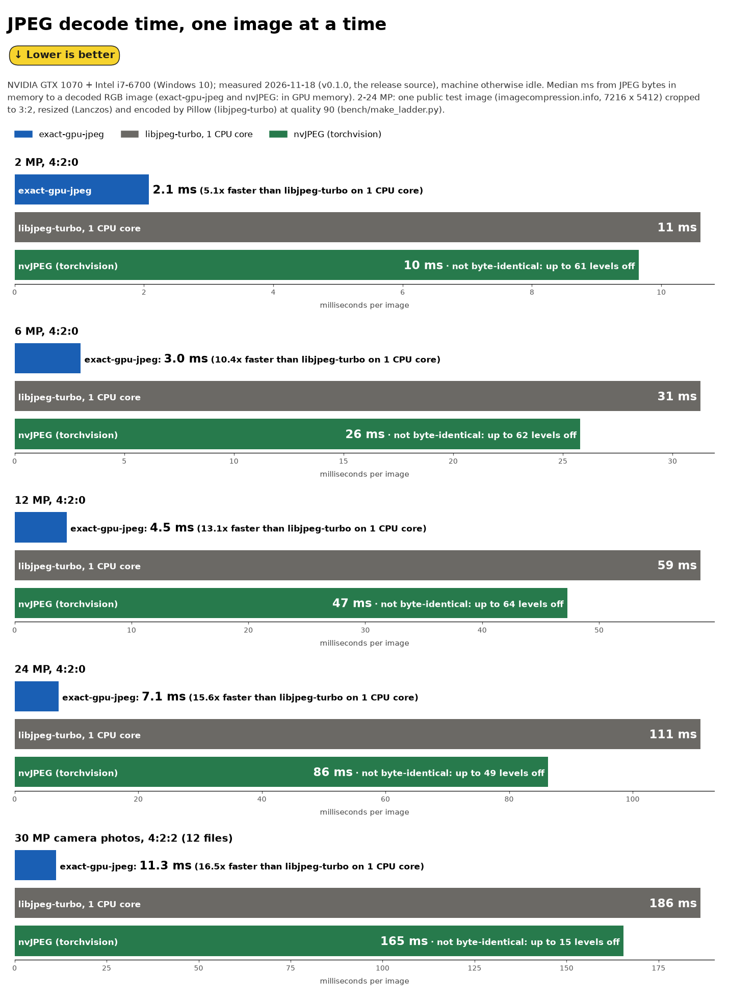
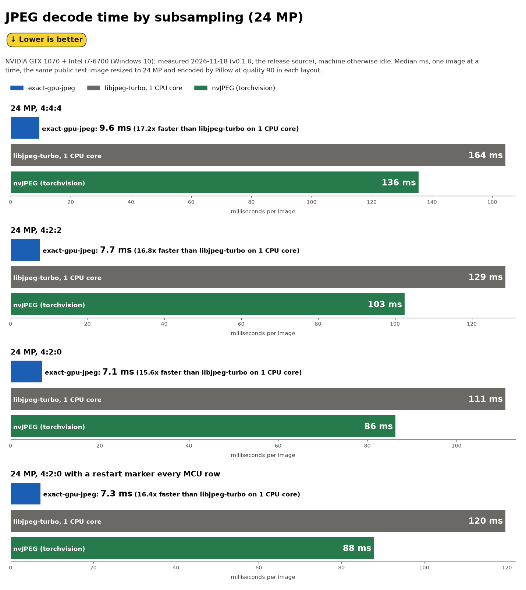

**Tasks**

# Reproduce the benchmark

Every number on this page is from one PC, an NVIDIA GTX 1070 (8 GB, Pascal, no hardware JPEG decoder) and an
Intel i7-6700 (4 cores, 8 threads) on Windows 10, and one script repeats the main tables on your own GPU.

## On your own GPU: `python bench/reproduce.py`

```bash
python bench/reproduce.py                       # the benchmark tables on your GPU, from generated images
```

It needs nothing but the library: it generates photo-like images, encodes them with Pillow, runs the three
comparisons and checks every result against libjpeg-turbo, exiting with status 1 if a pixel or a byte differs.
It prints the machine, the versions and `egj.device_report()` first. Options: `--quick`, `--out results.json`.

On the GTX 1070 + i7-6700 (Windows 10, driver 560.94, CuPy 14.2.0, simplejpeg 1.9.0 / libjpeg-turbo 3.1.2,
Pillow 13.0.0), 2026-11-18, the release source, machine otherwise idle ([full result](../bench/results/20261118/reproduce.json)):

**Decode, one image at a time (ms per image, lower is better)**

| size | file | libjpeg-turbo (simplejpeg), CPU | exact-gpu-jpeg | speed-up | decoded on | pixels equal to libjpeg-turbo's |
|---|---|---|---|---|---|---|
| 0.25 MP (616x408) | 35.7 kB | 0.80 | 1.03 | 0.8x | GPU | yes |
| 1 MP (1224x816) | 136.3 kB | 3.89 | 1.30 | 3.0x | GPU | yes |
| 2 MP (1736x1160) | 279.2 kB | 7.74 | 1.57 | 4.9x | GPU | yes |
| 6 MP (3000x2000) | 840 kB | 23.09 | 2.28 | 10.1x | GPU | yes |
| 12 MP (4240x2824) | 1655 kB | 44.89 | 3.14 | 14.3x | GPU | yes |
| 24 MP (6000x4000) | 3359.7 kB | 90.41 | 5.46 | 16.6x | GPU | yes |

The exact-gpu-jpeg column is the default call, with the pixels on the GPU at the end. Below the size limit
measured on the machine (`cpu_below`) it decodes on the CPU and uploads, and such a row is the CPU's time plus the
upload; in this run the limit was 166,294 pixels, so every size here decoded on the GPU.

**Decode, 64 different images per call (images per second, higher is better)**

| size | decode() in a loop | decode_batch() | speed-up | pixels equal |
|---|---|---|---|---|
| 0.25 MP (616x408) | 947 | 8,175 | 8.6x | yes |
| 1 MP (1224x816) | 716 | 3,284 | 4.6x | yes |

**Encode, quality 90, 4:2:0 (ms per image, lower is better)**

| size | Pillow (libjpeg-turbo), CPU | exact-gpu-jpeg | speed-up | file equal to Pillow's |
|---|---|---|---|---|
| 0.25 MP (616x408) | 1.00 | 0.41 | 2.4x | yes |
| 1 MP (1224x816) | 6.02 | 0.73 | 8.2x | yes |
| 2 MP (1736x1160) | 12.52 | 1.08 | 11.6x | yes |
| 6 MP (3000x2000) | 34.58 | 2.27 | 15.2x | yes |
| 12 MP (4240x2824) | 70.53 | 4.54 | 15.5x | yes |
| 24 MP (6000x4000) | 153.22 | 8.62 | 17.8x | yes |
<!-- numbers: bench/results/20261118/reproduce.json (environment; decode: kbytes, cpu_ms, gpu_ms, route, identical; batch: loop_per_s, batch_per_s; encode: cpu_ms, gpu_ms, identical; device_report.cpu_below.pixels) -->

Every result was identical. Please send the output from other cards.

## Against nvJPEG and libjpeg-turbo

```bash
python bench/nvjpeg_direct.py out.json <dir>    # nvJPEG through its own C API, this library and torchvision's route
```

Two groups, compared only within themselves. Images per second; 64 different JPEGs per size, made from 30 MP
camera photos (resized, quality 90, 4:2:0, baseline); the camera row is 12 original 30 MP photos (4:2:2).
Median of three rounds.

**One image at a time** (each call decodes one image and waits for it):

| size | this library, one call each | nvJPEG, `nvjpegDecode`, one state | libjpeg-turbo, one thread | nvJPEG through torchvision |
|---|---|---|---|---|
| 0.25 MP (616x408) | 887 | 947 | 1,122 | 866 |
| 0.5 MP (864x576) | **763** | 601 | 488 | 496 |
| 1 MP (1224x816) | **665** | 335 | 258 | 319 |
| 2 MP (1736x1160) | **548** | 178 | 130 | 172 |
| 6 MP (3000x2000) | **410** | 64 | 45 | 63 |
| 30 MP camera photos | **88.5** (11.3 ms each) | 6.1 | 5.4 | 6.1 |

**Many images at once** (the whole set in flight):

| size | this library, `decode_batch` | nvJPEG, `nvjpegDecode` with 8 states | nvJPEG, `nvjpegDecodeBatched` DEFAULT / GPU_HYBRID | libjpeg-turbo, 8 threads | nvJPEG through torchvision, batched |
|---|---|---|---|---|---|
| 0.25 MP | **7,310** | 1,203 | 1,013 / 1,562 | 3,046 | 977 |
| 0.5 MP | **4,942** | 709 | 573 / 934 | 1,700 | 564 |
| 1 MP | **3,194** | 405 | 306 / 530 | 846 | 336 |
| 2 MP | **1,881** | 214 | 159 / 288 | 440 | 178 |
| 6 MP | **730** | 79 | 56 / 101 | 154 | 65 |
<!-- numbers: bench/results/20261118/nvjpeg_direct.json -->

- **One at a time**, this library loses at 0.25 MP, to libjpeg-turbo on one thread and to nvJPEG's own API, and
  wins from 0.5 MP up.
- **Many at once**, this library's batches win at every size.
- **Across the groups:** one call per image is slower than the others' many-at-once routes up to 1 MP (at 1 MP,
  665 against libjpeg-turbo's 846 on eight threads). That is what `decode_batch` is for
  ([Decode many files in one call](batches.md)).
- **Output:** every image this library returned was byte-identical to libjpeg-turbo's. nvJPEG's differed on every
  image, whichever API and back end: by up to 38 to 50 levels in the size sets (mean 0.5 to 0.6) and up to 15 on
  the camera photos (mean 0.47).


| what was compared | how |
|---|---|
| machine | one NVIDIA GTX 1070 (8 GB, 2016) and an Intel i7-6700 (4 cores, 8 threads), Windows 10. This GPU has no hardware JPEG engine, so nvJPEG runs its CUDA path here; on cards that have the engine (A100 class) nvJPEG's hardware path would give different numbers. These results are for this card only |
| nvJPEG | version 12.3.3 (the `nvjpeg64_12.dll` that ships with torch 2.14.1, CUDA 12.6), called through its own C API: `nvjpegDecode` (one image per call, with one decoder state, and with eight in turn waiting every eight images) and `nvjpegDecodeBatched` (the whole set in one call, 8 CPU threads), each with the DEFAULT, HYBRID and GPU_HYBRID back ends (HYBRID and GPU_HYBRID single calls fall within DEFAULT's figures). The HARDWARE back end is refused on this card (status 7). nvJPEG decoded into buffers allocated beforehand and its batched decoder was set up before the timing, both in its favour |
| nvJPEG through torchvision | `torchvision.io.decode_jpeg(..., device="cuda")` (torchvision 0.29.1), the route most PyTorch users take |
| libjpeg-turbo | 3.1.2 through simplejpeg 1.9.0 (AVX2), accurate IDCT and fancy upsampling, to host memory |
| what is timed | from the JPEG bytes in host memory to the decoded RGB image: for the GPU decoders in GPU memory with the stream synchronised, for libjpeg-turbo in host memory (it would still have to be uploaded for GPU work). File reads are not included. The decoders take turns in each of three rounds, the order reversed in between |
| run | 2026-11-18, the release head, the GPU taken alone (a lock), the machine otherwise idle (`bench/results/20261118/nvjpeg_direct.conditions.json`) |

## The public image set

```bash
python bench/public_set.py out.json             # downloads two public archives, checks and times every JPEG
```

Images anyone can download, with no file in this repository: imagecompression.info's 8-bit RGB test images (14
photos of 3.4 to 39 MP) and libjpeg-turbo's three benchmark frames (1.2 MP rendered frames). The script downloads
the two archives into a cache folder outside the repository (`--cache DIR`; `--no-download` uses the ones already
there), checks their SHA-256, and makes every JPEG in memory with libjpeg-turbo through Pillow: quality 95 at
4:2:0, 4:2:2, 4:4:4 and gray (the settings of libjpeg-turbo's own performance page), quality 90 at 4:2:0, and
quality 95 at 4:2:0 with optimised Huffman tables. 17 images x 6 settings = 102 JPEGs.

| check | result |
|---|---|
| decoded on the GPU, pixels identical to libjpeg-turbo | 102 of 102 |
| encodes compared (colour, standard tables), byte-identical to Pillow's | 68 of 68 |
| decode from a packed copy, pixels identical | 102 of 102 |
| Pillow, OpenCV `imdecode`, torchvision on the CPU, libvips: identical to libjpeg-turbo | 102 of 102 each |
| nvJPEG (`torchvision.io.decode_jpeg`, `device="cuda"`, defaults): identical | 0 of 102; up to 110 levels at 4:2:0 (108 at quality 90), 77 at 4:2:2, 4 at 4:4:4, 1 for gray |
| libjpeg-turbo's own fast modes (fast IDCT + fast upsampling): identical | 0 of 102; up to 112 levels |
| nvJPEG's encoder (`torchvision.io.encode_jpeg`), quality 95, 4:4:4, 17 images | 0 of 17 byte-identical; 95.8% to 99.9% of libjpeg-turbo's size, 0.02 to 3.47 dB lower PSNR against the source (the two encoders need not mean the same thing by "quality 95") |
<!-- numbers: bench/results/20261118/public_set_run3.json (summary) -->

The other decoders are run only when they are installed.

Times, ms per image, one image at a time. Each decoder was called back to back for 0.3 s and then timed over 9
calls (median). This library and nvJPEG (through torchvision) end in GPU memory; libjpeg-turbo (simplejpeg, one
thread) ends in host memory. GTX 1070 + i7-6700, the GPU to itself (`public_set_run3.conditions.json`).

**The 14 photos** (3.4 to 39 MP). Speed-up of this library: median over the 14, then the range.

| setting | this library, ms | against libjpeg-turbo, one thread | against nvJPEG |
|---|---|---|---|
| q95 4:2:0 | 1.88 to 13.10 | 11.7x (5.6 to 17.5) | 10.9x (4.3 to 14.6) |
| q95 4:2:2 | 1.55 to 14.17 | 13.9x (9.2 to 19.1) | 13.1x (7.7 to 17.8) |
| q95 4:4:4 | 1.71 to 19.70 | 14.7x (12.8 to 18.3) | 13.7x (9.1 to 16.1) |
| q95 gray | 1.26 to 10.05 | 17.4x (5.4 to 21.0) | 13.0x (3.1 to 15.4) |
| q90 4:2:0 | 1.51 to 11.83 | 11.7x (3.6 to 27.3) | 10.8x (2.6 to 15.9) |
| q95 4:2:0, optimised tables | 1.76 to 14.71 | 10.7x (2.8 to 14.2) | 9.1x (2.3 to 12.9) |

**The three rendered frames** (libjpeg-turbo's benchmark set, 1.2 MP, large flat areas):

| setting | this library, ms | against libjpeg-turbo, one thread | against nvJPEG |
|---|---|---|---|
| q95 4:2:0 | 1.85 to 4.72 | 1.4x (1.2 to 2.4) | 1.4x (1.3 to 2.3) |
| q95 4:2:2 | 1.59 to 2.48 | 3.6x (2.4 to 4.6) | 3.3x (2.2 to 3.7) |
| q95 4:4:4 | 1.79 to 2.17 | 4.6x (2.8 to 4.6) | 3.5x (2.9 to 4.9) |
| q95 gray | 1.27 to 2.60 | 2.6x (2.2 to 3.3) | 2.1x (2.0 to 2.2) |
| q90 4:2:0 | 1.51 to 3.30 | 2.0x (1.3 to 2.6) | 1.7x (1.2 to 2.0) |
| q95 4:2:0, optimised tables | 1.74 to 4.22 | 1.5x (1.4 to 2.5) | 1.7x (1.5 to 2.2) |
<!-- numbers: bench/results/20261118/public_set_run3.json -->

- **No losses:** this library was the fastest of the three on all 102 JPEGs. Median 12.5x
  libjpeg-turbo on one thread and 10.7x nvJPEG.
- **The closest case** is a rendered frame (vgl_6548_0026, q95 4:2:0):
  3.92 ms, against 4.80 for libjpeg-turbo and 5.17 for nvJPEG. Rendered frames with large
  flat areas at 4:2:0 are where the margin is smallest: 1.2x to 2.4x.
- **Per coded megabyte.** A fit of ms = a + b x megapixels + c x coded MB over the images of 3 MP and more, per
  sampling (`bench/public_set.py --refit`). This library: 0.59 to 0.71 ms per MB. libjpeg-turbo: 6.78 to 7.69. nvJPEG:
  9.17 to 9.90. The standard errors are in the file.
- **The first run was replaced.** It is kept as `public_set.json`. It gave each decoder only two warm-up calls,
  while the GPU had idled between rows, and an idle card runs at a lower clock for its first 135 to 165 ms of work
  (`idle_gpu.json`). So this library's times came out up to 2x too high in some rows; 5 of the 102 then looked
  slower than libjpeg-turbo. libjpeg-turbo's and nvJPEG's times were not affected (median within 1 to 2 %).
  The harness now warms every decoder the same way. This section is the third run. A fourth with the same harness
  (`public_set_run4.json`) agreed: median ratio 0.98 for this library, 0.99 for both others, again no losses, the
  closest margin 1.23x. The second run (`public_set_run2.json`) ran without PyTorch, so without nvJPEG; it is kept
  as a record.

## zune-jpeg's and Google's benchmark files

Two more sets anyone can download, used as they are published (no re-encode): zune-jpeg's eight `speed_bench`
files (7680x4320; four baseline, in 4:4:4, 4:2:2, 4:4:0 and 4:2:0, and four progressive) and the nine files of
Google's Venice ladder (google/decoder-benchmarks-for-rust, 10x15 to 2000x3000, all progressive). Their SHA-256
values: `bench/results/20261118/public_files_sha256.txt`. `bench/bench.py`, GTX 1070 + i7-6700, one image at a time
from bytes in memory, medians, ms; libjpeg-turbo (simplejpeg 1.9.0) to host memory, the others to GPU memory:

| file | frame | this library's call | route | libjpeg-turbo, one thread | libjpeg-turbo, 8 threads (images/s) | nvJPEG (torchvision) | nvJPEG identical to libjpeg-turbo |
|---|---|---|---|---|---|---|---|
| speed_bench | 8K baseline 4:4:4 | 6.84 | GPU | 124.1 | 31.5 | 82.7 | no (up to 4 levels) |
| speed_bench_horizontal_subsampling | 8K baseline 4:2:2 | 5.61 | GPU | 107.4 | 33.5 | 59.4 | no (15) |
| speed_bench_vertical_subsampling | 8K baseline 4:4:0 | 6.12 | GPU | 177.9 | 24.4 | 58.9 | no (16) |
| speed_bench_hv_subsampling | 8K baseline 4:2:0 | 5.11 | GPU | 90.5 | 39.6 | 47.3 | no (22) |
| speed_bench_prog | 8K progressive | 400.4 | CPU | 357.6 | 7.9 | 166.9 | no (4) |
| speed_bench_prog_h_sampling | 8K progressive | 338.2 | CPU | 288.4 | 10.2 | 123.6 | no (15) |
| speed_bench_prog_v_sampling | 8K progressive | 374.7 | CPU | 341.4 | 9.6 | 129.9 | no (16) |
| speed_bench_prog_hv_sampling | 8K progressive | 370.0 | CPU | 339.0 | 9.1 | 122.1 | no (16) |
| venice-10x15 | progressive | 0.22 | CPU | 0.02 | 14,494 | 0.34 | no (11) |
| venice-20x30 | progressive | 0.25 | CPU | 0.03 | 13,996 | 0.35 | no (12) |
| venice-50x75 | progressive | 0.34 | CPU | 0.09 | 14,563 | 0.40 | no (23) |
| venice-100x150 | progressive | 0.58 | CPU | 0.29 | 9,655 | 0.65 | no (37) |
| venice-200x300 | progressive | 1.46 | CPU | 0.97 | 3,798 | 1.33 | no (34) |
| venice-500x750 | progressive | 7.39 | CPU | 6.27 | 610 | 5.46 | no (46) |
| venice-1000x1500 | progressive | 28.3 | CPU | 24.7 | 159 | 19.5 | no (44) |
| venice-1500x2250 | progressive | 62.4 | CPU | 54.4 | 71 | 42.6 | no (39) |
| venice-2000x3000 | progressive | 109.6 | CPU | 92.6 | 40 | 75.8 | no (46) |
<!-- numbers: bench/results/20261118/public_files.json -->

On the four 8K baseline files this library took 5.1 to 6.8 ms, against 90 to 178 ms for libjpeg-turbo on one
thread and 47 to 83 ms for nvJPEG, and its pixels were byte-identical to libjpeg-turbo's.

Progressive files are outside the GPU path. They cost the CPU decode (libjpeg-turbo itself) plus the upload of the
pixels to the GPU, so on all thirteen progressive files this library's call was slower than libjpeg-turbo on its
own: 338 to 400 ms against 288 to 358 ms at 8K, and 0.2 to 17 ms more on the Venice files. nvJPEG decodes
progressive files on the GPU and was faster than both at 8K (122 to 167 ms) and from 500x750 up, but its pixels
differed from libjpeg-turbo's on all 17 files of these two sets. A program that needs speed on progressive files
and not output identical to libjpeg-turbo's is better served by nvJPEG for them.

## Conditions of the longer tables

```bash
python bench/make_ladder.py big_building.ppm <out dir>   # the public image cropped to 3:2, resized to 2, 6, 12 and 24 MP in four layouts
```

NVIDIA GTX 1070 (8 GB, Pascal, no hardware JPEG decoder), Intel i7-6700 (4 cores, 8 threads), Windows 10, CuPy 14.2 /
CUDA 12, simplejpeg 1.9.0 (libjpeg-turbo 3.1.2, AVX2), torch 2.14.1 + torchvision 0.29.1 (nvJPEG from CUDA 12.6),
Pillow 13.0.0. Each run had the GPU to itself on an otherwise idle machine (`bench/with_lock.py`; conditions are
recorded next to each result). Decode inputs: the public image above cropped to 3:2, resized and encoded by Pillow
at 2, 6, 12 and 24 MP, quality 90, and 12 original 30 MP camera JPEGs (4:2:2), local. Raw results:
`bench/results/`; charts: `bench/charts.py`.

The tables dated 2026-11-16 were measured before the per-call tuning of 2026-11-17, which shortened every
single-image call and slowed none ([paired rounds](../bench/results/20261117/call_floor_paired.md)): a 64x64 decode
went from 1.84 to 0.75 ms, a 1 MP decode from 1.95 to 1.46 ms, a 488x480 encode from 1.06 to 0.41 ms, a 30 MP decode
from 12.6 to 11.7 ms; batches of 64 and large encodes are unchanged.
<!-- numbers: README.md "Benchmarks" intro / bench/results/20261117/call_floor_paired.md -->

## Decoding

```bash
python bench/bench.py out.json name=<dir> ...   # decode: vs simplejpeg and nvJPEG
```

Every decoder starts from the JPEG bytes in memory. libjpeg-turbo (simplejpeg, accurate IDCT, fancy upsampling) ends
with the image in host memory; exact-gpu-jpeg and nvJPEG (`torchvision.io.decode_jpeg(device="cuda")`) in GPU
memory. Latency is the median of one image at a time; throughput repeats the set with N CPU threads, N GPU decoder
threads, or nvJPEG's batched call.






| image | MB | libjpeg-turbo, ms | **exact-gpu-jpeg, ms** | nvJPEG, ms | CPU 1 thread /s | CPU 8 threads /s | **GPU 1 thread /s** | **GPU 2 threads /s** | nvJPEG batched /s | nvJPEG max diff |
|---|---|---|---|---|---|---|---|---|---|---|
| 02 MP 4:4:4 | 0.84 | 14.8 | **1.5** | 13.5 | 64 | 266 | **544** | **577** | 74 | 4 |
| 02 MP 4:2:2 | 0.73 | 12.1 | **1.6** | 11.0 | 82 | 347 | **576** | **577** | 92 | 40 |
| 02 MP 4:2:0 | 0.68 | 10.6 | **2.1** | 9.7 | 89 | 388 | **444** | **462** | 92 | 61 |
| 02 MP 4:2:0 + restart | 0.68 | 11.1 | **1.9** | 9.8 | 88 | 357 | **473** | **494** | 104 | 61 |
| 06 MP 4:4:4 | 2.36 | 43.4 | **2.8** | 37.3 | 22 | 96 | **330** | **348** | 26 | 4 |
| 06 MP 4:2:2 | 2.01 | 35.4 | **2.5** | 29.5 | 27 | 119 | **358** | **382** | 33 | 48 |
| 06 MP 4:2:0 | 1.84 | 31.3 | **3.0** | 25.8 | 31 | 131 | **308** | **325** | 38 | 62 |
| 06 MP 4:2:0 + restart | 1.84 | 31.6 | **2.8** | 25.9 | 31 | 128 | **323** | **344** | 38 | 62 |
| 12 MP 4:4:4 | 4.43 | 85.2 | **5.0** | 71.9 | 11 | 51 | **178** | **198** | 14 | 4 |
| 12 MP 4:2:2 | 3.69 | 69.5 | **4.1** | 56.2 | 14 | 61 | **227** | **238** | 18 | 37 |
| 12 MP 4:2:0 | 3.34 | 58.7 | **4.5** | 47.3 | 17 | 68 | **210** | **225** | 21 | 64 |
| 12 MP 4:2:0 + restart | 3.34 | 60.4 | **4.5** | 47.5 | 16 | 65 | **210** | **220** | 21 | 64 |
| 24 MP 4:4:4 | 8.08 | 164.5 | **9.6** | 135.6 | 6 | 27 | **105** | **111** | 7 | 4 |
| 24 MP 4:2:2 | 6.60 | 128.8 | **7.7** | 102.6 | 8 | 33 | **119** | **136** | 10 | 39 |
| 24 MP 4:2:0 | 5.89 | 111.0 | **7.1** | 86.3 | 9 | 37 | **131** | **144** | 11 | 49 |
| 24 MP 4:2:0 + restart | 5.89 | 119.7 | **7.3** | 87.9 | 9 | 35 | **132** | **141** | 11 | 49 |
| camera photos, 30 MP 4:2:2 (12, local) | 11.16 | 186.5 | **11.3** | 165.5 | 5 | 24 | **88** | **93** | 6 | 15 |

All rows: v0.1.0 on the release source, one run on 2026-11-18 (`bench/results/20261118/bench.json`; conditions in `bench.conditions.json` next to it); every file decoded on the GPU, byte-identical to libjpeg-turbo.
<!-- numbers: README.md "Benchmarks" > "Decoding" / bench/results/20261118/bench.json -->

| where it loses or gains little | |
|---|---|
| small images, one call per image | one call per image loses at 0.25 MP to libjpeg-turbo on one thread (887 against 1,122 images/s), and up to 1 MP to libjpeg-turbo on 8 CPU threads (665 against 846 at 1 MP; [the table above](#against-nvjpeg-and-libjpeg-turbo)): per-image Python and launch overhead dominates. Decoding them as a batch removes that overhead. From 2 MP up the GPU wins even one image at a time: at 2 MP one GPU thread decodes 444–576 images/s against 266–388 on all eight CPU threads; at 24 MP one image decodes 15.6–17.2× faster than on one CPU thread, and throughput is 3.6–4.2× that of all eight CPU threads |
| nvJPEG | on this GPU it has no hardware decoder; on 30 MP camera files it is only a little faster than one CPU core (165 vs 186 ms through torchvision; 147 ms at best through its own API), and its pixels differ from libjpeg-turbo's by up to 64 levels at 4:2:0 on the ladder (mean 0.8 to 0.9) and up to 15 on the camera photos |
| NVIDIA DALI | not measured: DALI 2.4.0 ships Linux wheels only (x86-64 and aarch64), none for Windows. This PC has WSL2, which could run it, but that compares across operating systems; left for a Linux machine |
| upload | a CPU-decoded image still has to be uploaded for GPU work (about 2–3 ms for 30 MP over PCIe here); the GPU numbers already include the upload of the compressed file |

## Straight to a model input

```bash
python bench/epilogue_bench.py <dir>            # decode straight to a normalised float16 CHW array against decode-then-convert
```

Decoding the 12 camera photos to a normalised float16 CHW array (ImageNet mean and std) takes **14.0–14.3 ms** per
photo with the output options (`dtype`, `layout`, `scale`, `bias`), against 26.6–28.4 ms for decoding to uint8 and
converting with CuPy, with the same float16 bits, three rounds on the release source (`bench/results/20261118/epilogue.json`).
<!-- numbers: bench/results/20261118/epilogue.json (fused_ms, decode_then_cupy_ms: lowest to highest of 3 rounds; identical) -->

## Batches

```bash
python bench/batch_bench.py out.json <dir>      # batches of small images: vs one call each, CPU threads, nvJPEG
python bench/batch_bench.py out.json <dir> --vary   # every file of a set a different size
```

64 different JPEGs per size (the 12 camera photos and crops of them, resized, quality 90, 4:2:0), from bytes in
memory to decoded images, images per second; every GPU image byte-identical to libjpeg-turbo, all 64 of each set
decoded in one batch. Two groups, compared only within themselves.

**One image at a time** (each call decodes one image and waits for it):

| image | KB | this library, one `decode` per image | libjpeg-turbo, one thread |
|---|---|---|---|
| 0.25 MP (616×408) | 44 | 817 | **1,076** |
| 0.5 MP (864×576) | 78 | **721** | 477 |
| 1 MP (1224×816) | 144 | **625** | 235 |
| 2 MP (1736×1160) | 272 | **553** | 126 |
| 6 MP (3000×2000) | 759 | **413** | 44 |

**Many images at once:**

| image | this library, batches of 8 / 16 / 32 / 64 | libjpeg-turbo, 4 / 8 CPU threads | nvJPEG through torchvision, batched |
|---|---|---|---|
| 0.25 MP (616×408) | 2,535 / **4,124** / **5,560** / **6,774** | 2,025 / **2,906** | 966 |
| 0.5 MP (864×576) | **2,337** / **3,433** / **4,424** / **5,101** | 1,369 / 1,722 | 564 |
| 1 MP (1224×816) | **1,610** / **1,992** / **2,784** / **3,129** | 661 / 728 (846 in the nvJPEG run, see below) | 334 |
| 2 MP (1736×1160) | **1,279** / **1,574** / **1,762** / **1,873** | 356 / 438 | 179 |
| 6 MP (3000×2000) | **613** / **688** / **714** / **724** | 121 / 149 | 66 |
<!-- numbers: bench/results/20261118/batch.json (every row and column of both tables above) -->

Source of both tables: `bench/results/20261118/batch.json`, one run. The same sets with every file a different
size (widths 8 px apart, `--vary`, `bench/results/20261118/batch_varied.json`): batches of 64 at 6,950 / 4,709 /
3,098 / 1,847 / 713 images/s, within 8 % of the plain sets at every size. nvJPEG through its own C API is in
[Against nvJPEG and libjpeg-turbo](#against-nvjpeg-and-libjpeg-turbo), a separate run with its own table.

- **One at a time**, libjpeg-turbo on one thread is faster at 0.25 MP (1,076 against 817); this library is faster
  from 0.5 MP up.
- **Many at once**, batches of 64 decode 2.3–4.8× what all eight CPU threads do and 7.0–11× nvJPEG's batched
  call through torchvision. One loss in this group: at 0.25 MP, batches of 8 (2,535) are slower than libjpeg-turbo
  on eight threads (2,906). At that size this library starts winning at batches of 16 (4,124). From 0.5 MP up,
  batches of 8 already win.
- **Across the groups:** one `decode` per image is slower than libjpeg-turbo on eight threads up to 1 MP (817
  against 2,906 at 0.25 MP, 625 against 728 at 1 MP). It is also slower than nvJPEG's batched call at 0.25 MP (966
  against 817). A batch is where small images win: batches of 64 decode 8.3× (0.25 MP) to 1.8× (6 MP) as many
  images as one call each.
- **Spread between runs.** The same 64-file sets were also timed, on the same day and head, in the nvJPEG run
  (`nvjpeg_direct.json`, median of three rounds, where this table takes one run of at least 2 s each). Figures that
  differ by more than 5 % between the two runs:
  - libjpeg-turbo at 1 MP: 235 here against 258 there on one thread, 728 against 846 on eight threads;
  - this library's one call per image: 817 against 887 at 0.25 MP, 721 against 763 at 0.5 MP, 625 against 665
    at 1 MP;
  - this library's batches of 64 at 0.25 MP: 6,774 against 7,310.

  Every other figure the two runs share agrees within 5 %.

## Encoding

```bash
python bench/encode_bench.py out.json <dir>     # encode: vs Pillow and simplejpeg
```

Three web export settings, 6 camera photos resized (Lanczos) with their EXIF. Pillow is the encoder whose bytes this
library matches. simplejpeg (libjpeg-turbo through TurboJPEG, not byte-compatible with Pillow) is the fast CPU
reference. Every encoder ends with the JPEG bytes in host memory. This library is timed from two starting points:

- **pixels in host memory** (a NumPy array), as the CPU encoders start: the upload is included. This is the
  like-for-like comparison with Pillow and simplejpeg;
- **pixels already on the GPU** (a decode, edit, encode pipeline): only the compressed bytes cross PCIe (2.5 MB
  instead of 29.5 MB of RGB at 3840×2560).

![Encoding a photo's three web exports one at a time on a GTX 1070 + i7-6700, ms per image (lower is better): at 3840 x 2560 (quality 95, 4:4:4) exact-gpu-jpeg takes 15.0 ms from host memory and 5.18 ms with the pixels already on the GPU, against 60.4 ms for simplejpeg and 90.6 ms for Pillow on one CPU thread; at 1500 x 1000, 2.64 and 1.05 ms against 7.90 and 11.3 ms; at 1200 x 800 (quality 87, 4:2:0), 1.73 and 0.78 ms against 2.84 and 5.21 ms. exact-gpu-jpeg's files are byte-identical to Pillow's; simplejpeg's are not.](images/encode.png)

**One image at a time** (ms per image, lower is better):

| export | JPEG MB | this library, from host memory | this library, from GPU memory | simplejpeg, one thread | Pillow, one thread |
|---|---|---|---|---|---|
| 3840×2560 q95 4:4:4 | 2.51 | **15.0** | 5.18 | 60.4 | 90.6 |
| 1500×1000 q90 4:4:4 | 0.29 | **2.64** | 1.05 | 7.90 | 11.3 |
| 1200×800 q87 4:2:0 | 0.15 | **1.73** | 0.78 | 2.84 | 5.21 |

**Many images at once** (images per second, higher is better). This library has no batch call for encoding, so two
threads are its many-at-once route:

| export | this library from host memory, 1 / 2 threads | from GPU memory, 1 / 2 threads | simplejpeg, 4 / 8 threads | Pillow, 4 / 8 threads |
|---|---|---|---|---|
| 3840×2560 q95 4:4:4 | 66 / **70** | 188 / 218 | 50 / 66 | 13 / 13 |
| 1500×1000 q90 4:4:4 | 337 / 378 | 661 / 772 | 376 / **482** | 93 / 91 |
| 1200×800 q87 4:2:0 | 538 / 567 | 1,049 / 972 | 1,060 / **1,305** | 201 / 204 |
<!-- numbers: bench/results/20261118/encode.json (both tables) -->

- **One at a time, from host memory**, this library is faster than both CPU encoders at every size: 1.6× simplejpeg
  at 1200×800 up to 4.0× at 3840×2560.
- **Many at once, from host memory**, simplejpeg on eight threads is faster at 1500×1000 (482 against 378) and at
  1200×800 (1,305 against 567). This library is faster only at 3840×2560 (70 against 66).
- **With the pixels already on the GPU**, simplejpeg on eight threads is still faster at 1200×800 (1,305 against
  1,049), and on four threads it is level (1,060 against 1,049).
- Two GPU threads are slower than one at 1200×800 from GPU memory (972 against 1,049). The likely cause is the two
  threads contending for each call's host-side work; it was not measured further.
- Pillow gains only 1.1–1.2× from threads.
- All three exports of one photo back to back, from GPU memory: 7.35 ms, against 103 ms with Pillow.

Where GPU encoding does not pay: [Encode](encode.md#when-gpu-encoding-does-not-pay).

## One small image and the fixed cost of a call

```bash
python bench/small_image.py out.json <dir>      # one small image: the CPU route (the default) vs always the GPU
python bench/call_floor.py out.json             # where the time of one decode() and encode() call goes
```

| image | default route | always the GPU |
|---|---|---|
| 0.02 MP 4:2:0 | 0.37 (CPU) | 1.01 |
| 0.05 MP 4:2:0 | 0.51 (CPU) | 0.96 |
| 0.1 MP 4:2:0 | 0.72 (CPU) | 1.01 |
| 0.1 MP 4:4:4 | 0.87 (CPU) | 0.81 |
| 0.15 MP 4:2:0 | 0.90 (CPU) | 1.12 |
| 0.2 MP 4:2:0 | 1.13 (CPU) | 1.09 |
| 0.2 MP 4:4:4 | 1.38 (CPU) | 0.85 |
| 0.25 MP 4:2:0 | 1.36 (CPU) | 1.11 |
| 0.5 MP 4:2:0 | 1.31 (GPU) | 1.31 |
<!-- numbers: bench/results/20261118/small_image.json (medians of 8; limit_at_start 259,010) -->

ms per call, medians of 8, GTX 1070 + i7-6700, Windows 10, on 2026-11-19. The run started from an empty settings
folder, so it used the limit a new user gets: measured at the start, 259,010 pixels. That measurement varies from
run to run: `bench/reproduce.py`, run straight after in another empty folder, measured 166,294, which sends the
0.2 and 0.25 MP images to the GPU. On this PC the CPU route wins at 4:2:0 up to 0.15 MP and is about even at
0.2 MP; at 4:4:4 the GPU is already faster at 0.1 MP. The measurement does not yet take the subsampling into
account, so a 4:4:4 image below the limit takes the slower route. `cpu_below=0` always uses the GPU.

Each `decode` call on the GPU has a fixed cost of about 0.58 ms (13 GPU steps and one host round trip), a
small `encode` about 0.3 ms (`bench/call_floor.py`, [call_floor.json](../bench/results/20261118/call_floor.json)).
<!-- numbers: bench/results/20261118/call_floor.json (16x16: decode call median 0.58 ms, 13 GPU steps; encode 0.26 ms); bench/results/20261118/reproduce.conditions.json (cpu_below_before_run 166,294) -->

## Decode speed-ups made in this repository

```bash
python bench/decode_alone.py out.json <dir>     # decode from disk: stage times, threads, the upload_ahead stream
```


| step | wall ms | GPU: upload / Huffman / pixels ms | photos/s, 1 thread | 2 threads |
|---|---|---|---|---|
| baseline (the first working version) | 19.3 | 2.0 / 9.65 / 3.35 | 52 | 65 |
| branch-free coefficient writer | 18.9 | 2.0 / 9.34 / 3.33 | 53 | 64 |
| in-block synchronisation, device-side convergence, no host wait | 18.6 | 2.1 / 8.57 / 3.29 | 54 | 67 |
| unstuffing with 16-byte loads | 18.2 | 2.1 / 8.45 / 3.30 | 56 | 69 |
| write pass from the checkpoints, 4096-bit chunks | 16.4 | 2.0 / 7.20 / 3.13 | 61 | 77 |
| v0.1: chunk size per image, table slots in registers, unstuffing fast path; IDCT with 16-byte loads, colour kernel per subsampling, bit-mask unstuffing, fewer launches | **14.8** | 1.99 / **5.33** / **2.93** | **70** | **95** |
<!-- numbers: README.md "Decode speed-ups made in this repository" / bench/results/speed/ -->

30 MP 4:2:2 camera photos read from disk, each step measured on its own. Every row reads the whole file, then uploads
it (`EGJ_STREAM_READ=0`). Read in pieces (the default), the same sitting gave 13.4 ms and 75 / 87 photos/s on 1 / 2
threads, and whole files were faster with two threads (`bench/results/speed/s8_loop_decoder*.json`).

## What was not measured

```bash
python bench/reproduce.py                       # on a card that is not a GTX 1070, and send the output
```

Speed on any card other than the GTX 1070; Linux; a recent GPU (Ampere or newer); a GPU with nvJPEG's hardware
engine, where nvJPEG may well be faster; CUDA 11; NVIDIA DALI. Tried and dropped: a DC-only IDCT shortcut (no gain
on camera photos), 15 checkpoints per chunk (slower).

## Related

- [Who it is for](use-cases.md)
- [Decode many files in one call](batches.md)
- [Small images and the CPU route](small-images.md)
- [The first call, warm-up and an idle GPU](first-call.md)

**Next:** [When something is wrong](troubleshooting.md)
