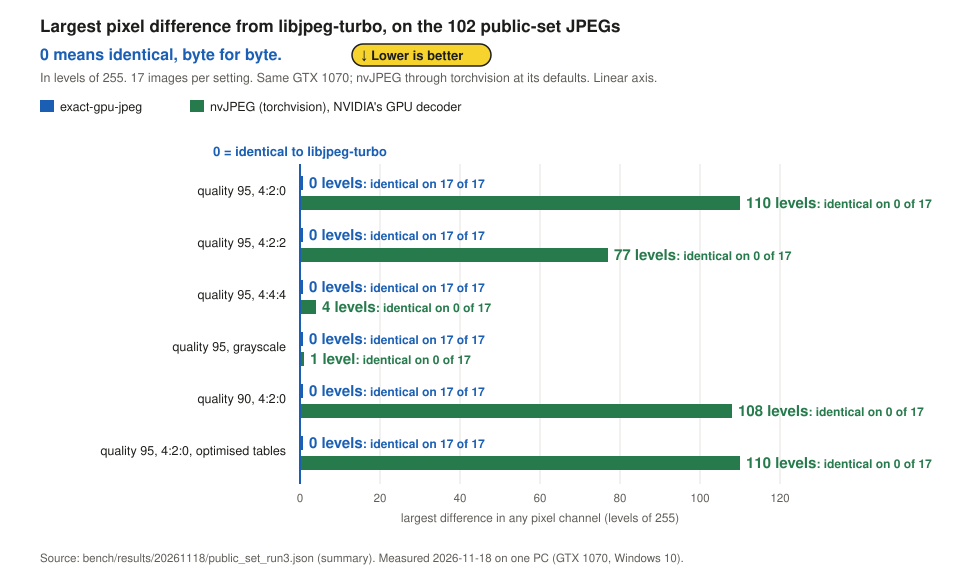
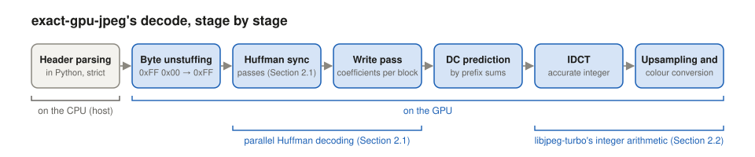
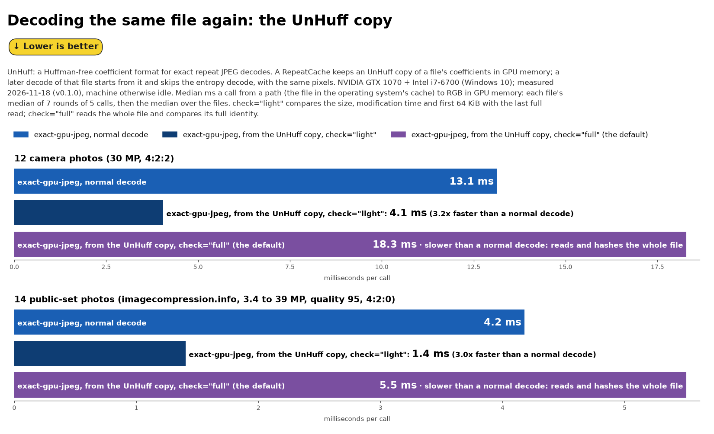
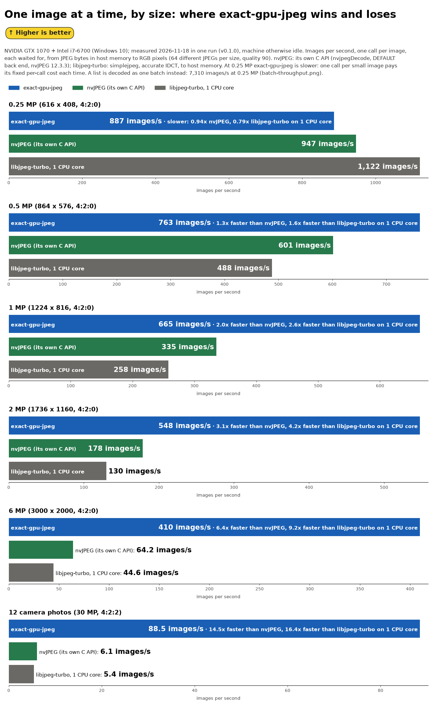
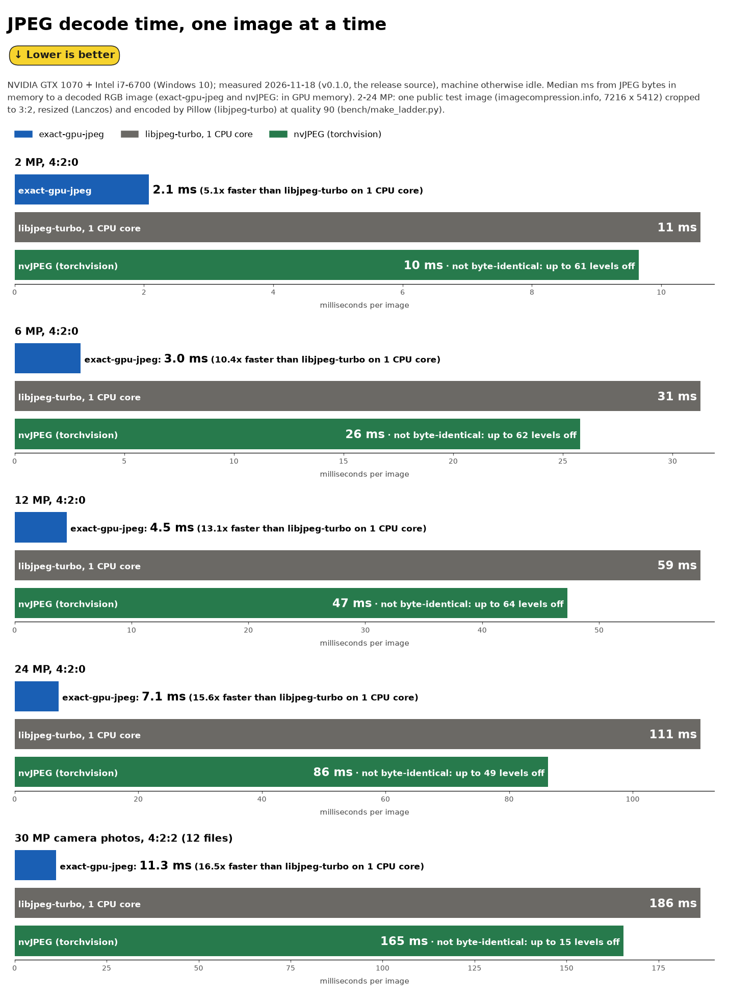
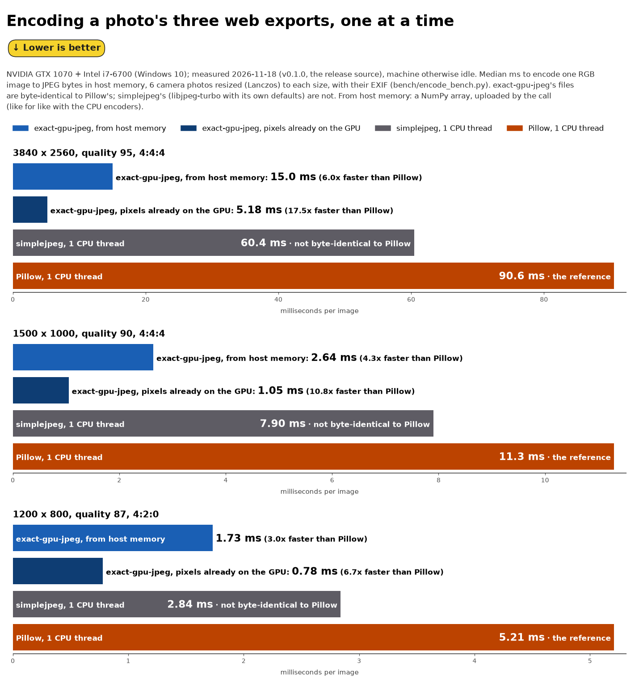

# exact-gpu-jpeg 0.1.0: JPEG decoding and encoding on NVIDIA GPUs with the CPU reference's exact bytes

*In memory of Rudy Sepp, Enoch Carlson and Timothy Carlson.*

**Luke Riley** · November 2026 · version 0.1.0

---

## Abstract

GPU JPEG decoders are fast, but their pixels differ from the CPU libraries'. Moving JPEG work to the GPU has therefore
meant changing results: test baselines, caches and the inputs a model was trained on all shift. exact-gpu-jpeg is a
Python/CuPy library for NVIDIA GPUs whose decoded pixels are byte-identical to libjpeg-turbo's and whose encoded
files are byte-identical to Pillow's. It decodes the whole file on the GPU, Huffman stage included, by
self-synchronising parallel decoding, then runs integer arithmetic ported from libjpeg-turbo. Files it cannot
reproduce exactly are handed to the CPU reference library, never approximated. Evidence: 2,250 test files (1,259
of them real camera and phone photos), 120,000 fuzzed inputs, and 102 public JPEGs anyone can rebuild to reproduce the tests and results; every file
decoded on the GPU was byte-identical to libjpeg-turbo, and 68 of 68 comparable public-set encodes matched Pillow.
On one GTX 1070, a 30 MP camera photo (4:2:2), decoded one at a time from bytes in host memory, took 11.3 ms against
185 ms for libjpeg-turbo on one CPU core and 164 ms for nvJPEG on the same GPU. It loses on one small image at a
time (at 0.25 MP, 887 images a second against 1,122 for libjpeg-turbo on one thread), on small encodes against
eight CPU threads, and on progressive files, which go to the CPU. Everything was measured on one PC.

*A sister library for Apple GPUs, [exact-jpeg-metal](https://github.com/mrluker/exact-jpeg-metal), makes the same
byte-identical claim on Macs and iPhones and was tested on the same 102 public JPEGs.*

---

## 1. Why exactness matters

On the public test set (Section 4.3, 102 JPEGs), Pillow, OpenCV, torchvision's CPU decoder and libvips each gave
libjpeg-turbo's pixels on 102 of 102 files. nvJPEG, NVIDIA's GPU JPEG
library, called through torchvision at its defaults, was identical on 0 of 102. It differed by up to 110 levels (of
255) at 4:2:0, 77 at 4:2:2, 4 at 4:4:4 and 1 for grayscale. On 64 resized photos per size it differed on every
image through every API and back end tried, by up to 38 to 50 levels (mean 0.52 to 0.64), and on 12 camera photos by
up to 15 (mean 0.47). nvJPEG's encoder, compared at quality 95, 4:4:4 with libjpeg-turbo's file, was byte-identical
on 0 of 17 images, with files 95.8% to 99.9% of the size and 0.02 to 3.47 dB lower in PSNR against the source. The two
encoders need not mean the same thing by "quality 95"; this is a statement about one setting.

Identical bytes mean that JPEG work moves to the GPU without changing any result. In applications built on this
library, tests, caches and file hashes keep working. When training an AI model on images, the model sees the same
pixels in training and in production, whichever machine decoded them. And a file the GPU declines is decoded on the
CPU with no loss in quality and no difference in the result, so a fleet mixing CPU and GPU machines for decoding and
encoding gives consistent results.

**Definitions.** *Decoding:* every byte of the decoded pixel array (RGB, BGR or grayscale, uint8) equals what
libjpeg-turbo 3.1.2 (as bundled in simplejpeg 1.9.0) returns with its accurate integer IDCT and fancy upsampling,
in each of its x86-64 code paths (AVX2, SSE2, plain C); Pillow 13.0.0 (libjpeg-turbo 3.2.0) gave the same images.
This covers 8-bit baseline and extended-sequential Huffman JPEGs with one scan, grayscale or YCbCr, at 4:4:4, 4:2:2,
4:2:0, 4:4:0, 4:1:1 and other integral sampling factors, with or without restart markers, with any valid Huffman
tables. *Encoding:* every byte of the file equals Pillow 13.0.0 with its default settings, for RGB uint8 images at
quality 1 to 100, 4:4:4, 4:2:2 or 4:2:0, with or without an ICC profile and EXIF.

Three terms recur. **Subsampling** stores the two colour channels at lower resolution: 4:2:2 halves them
horizontally, 4:2:0 in both directions. An **MCU** (minimum coded unit) is the group of 8×8 blocks from every
channel that covers one region, 16×16 pixels at 4:2:0. A **restart marker** is an optional marker every fixed number
of MCUs at which the decoder's state resets; most camera JPEGs have none.

---

## 2. Design

### 2.1 Huffman decoding in parallel

The decode runs as: header parsing (Python, strict) → removal of byte stuffing → Huffman synchronisation passes and
a write pass → DC prediction by prefix sums → IDCT → upsampling and colour conversion. Everything after the header
runs on the GPU.

The compressed data is one long string of variable-length Huffman codes whose meaning depends on everything before
them, so the obvious decoder is sequential, and on a CPU this is the most expensive stage. exact-gpu-jpeg uses the self-synchronisation method of Weißenberger and Schmidt (Section 8): a decode
started at a wrong bit position lands, after typically tens to a few hundred bits, on a true code boundary and
follows the true decode from then on. JPEG's extra state (which block of the MCU, which coefficient) synchronises
too, because block ends are frequent.

The stream is cut into chunks, one GPU thread each: 1,024 bits when the compressed data is under 200,000 bytes,
2,048 bits under 6,000,000 bytes, and 8,192 bits above (a 30 MP camera photo). Each chunk decodes from a guessed
state, runs to the first symbol boundary past its end, and records its exit state, its block count and 7 interior
checkpoints (15 in an 8,192-bit chunk).
Within a CUDA thread block of 128 chunks, each chunk compares its entry with its neighbour's exit and re-decodes
until nothing changes; a re-decode stops at the first matching checkpoint, so most are short. Global passes carry
exits across thread blocks, launched three at a time without host checks. On camera photos the first pass
synchronises everything and the second confirms it. If three are not enough, the decode is redone with at most 5
more passes; then the file is declined to the CPU. At the fixed point a prefix sum numbers the blocks, and a write
pass runs one thread per checkpoint piece (8 or 16 per chunk), each from a known-true state.

Restart intervals become independent segments, so restart markers make decoding faster but are not needed. The
write pass sets an error bit for every way the data can be wrong (a code not in the table, a run past coefficient
63, data that ends early), and any error bit declines the image. Every real photo measured settled in 2 passes.

### 2.2 Integer arithmetic from libjpeg-turbo

After the Huffman stage, everything is libjpeg-turbo's integer arithmetic re-implemented for CUDA from its 3.1.2
sources (no file copied; every ported routine and change is listed in the third-party notices): the accurate IDCT
`jpeg_idct_islow` with unsigned 32-bit intermediates and saturating clamps, as libjpeg-turbo's SIMD code does; fancy
upsampling and the fixed-point YCbCr tables, evaluated per output pixel and specialised per subsampling; and
libjpeg-turbo's meaning for every Huffman symbol.

For extreme coefficient values, libjpeg-turbo's 16-bit SIMD IDCT and its C IDCT give different pixels, so its output
would depend on the build. The GPU computes exactly, flags those blocks, and declines the file. The documentation
notes that no real 8-bit encoder produces such coefficients. Opt-in modes reproduce libjpeg-turbo's other settings,
never by default: `fast_dct=True` (its fast IDCT, declining blocks where its SIMD and C versions disagree) and
`fast_upsample=True`.

### 2.3 Declines, the CPU fallback and strict mode

The GPU path declines progressive, arithmetic-coded, lossless, hierarchical, 12-bit, RGB-coded and multi-scan files,
fractional sampling factors, and coefficients on which libjpeg-turbo's code paths disagree. `decode()` then uses the
CPU decoder, which is the reference library itself (simplejpeg, libjpeg-turbo's TurboJPEG API), and uploads the
result; `info["path"]` says which route ran. CMYK and YCCK files are outside the claim. Where Pillow stands in, the
result reports `warnings_checked = False`, because Pillow decodes past libjpeg-turbo's warnings silently.

Files libjpeg-turbo decodes only with a warning (no end marker, extraneous bytes before a marker, a JFIF version
other than 1.x, a malformed ICC profile and others) are declined by the GPU path by default, and the CPU decoder
raises for them too. With `strict=False` the call returns libjpeg-turbo's image and names the warning. A file
libjpeg-turbo rejects is rejected by both routes.

### 2.4 Safety with bad input

A decode returns an image or `None` with a reason. Before any GPU work, the header parser checks every marker
length, dimensions, sampling factors and tables, and estimates the GPU memory needed against a budget. In the
kernels the bit reader cannot read past its buffer, other indices are bounded by header sizes, and every loop is
bounded independently of the file: one synchronisation launch decodes at most 600,000,000 bytes of entropy-coded
data, and a file gets at most 8 launches. A test mode (`EGJ_CANARY=1`) surrounds every device buffer with 64 KB
guard bands.

### 2.5 The encoder

Per 8×8 block on the GPU: colour conversion, downsampling and edge padding, the accurate forward DCT, and
quantisation by reciprocals as in libjpeg-turbo's 16-bit SIMD builds. Each block's Huffman bits are counted, a
prefix sum gives offsets, every block writes its bits in parallel, and a separate pass inserts the 0x00 after each
0xFF byte. Only the compressed bytes are copied back. The header is built on the host in the order Pillow 13.0.0
writes it, matched by comparing output (JFIF, EXIF in APP1, the ICC profile in APP2 segments of at most 65,519
bytes, then the tables); no Pillow code is included. Only Pillow's default kind of file is written.

### 2.6 Routes and self-configuration

One image goes to the GPU. A list is decoded as a batch: files that share Huffman tables and sampling factors are
laid end to end as one stream of independent segments, decoded in about 15 GPU launches for the whole batch (one
call per file takes 13). Others are decoded one by one inside the same call. One small image goes to the CPU and is
uploaded, because each GPU `decode` call has a fixed cost of about 0.58 ms (13 GPU steps and one host round trip),
and a small `encode` about 0.3 ms.

On a card it has not seen, the library configures itself, and `device_report()` shows every choice:

- **Device check** before any kernel compiles: compute capability (5.0 minimum), memory, the kernel compiler.
- **Self-check** once per process and GPU: built-in decodes, a batch and two encodes, compared with SHA-256 hashes
  stored in the package. A wrong byte or any CUDA error turns the GPU path off with one warning, and `decode()`
  then returns the CPU decoder's pixels.
- **Small-image threshold** (`cpu_below`): three built-in images timed through both routes, about a quarter of a
  second in a background thread, kept between 50,000 and 500,000 pixels (200,000 until measured). It can be
  pinned; `cpu_below=0` always uses the GPU. Either route gives the same pixels.
- **Derived settings:** a decode budget of 90% of free GPU memory, and batch data scaled to the card's memory.
  Values tuned on the GTX 1070 can be overridden; on another card they can cost speed, and by design they do not
  change a byte (no other card has been tested).

---

## 3. The repeat cache: UnHuff

*UnHuff: a Huffman-free coefficient format for exact repeat JPEG decodes.*

A viewer, a preview or a culling pass often decodes the same file several times. `RepeatCache` keeps an UnHuff copy
of a file's decoded coefficients in GPU memory, so a later decode of that file skips the entropy decode and runs
only the pixel stage. The pixels are the same as a fresh decode's, byte for byte, with every output option. It is
off by default; without it nothing about a file is kept. Underneath, `Decoder(keep_coefs="packed")` with
`take_coefs()` and `decode_from_handle()` lets a program keep copies by its own rules.

A copy is filed under the identity of the JPEG's bytes (the SHA-256 of each 64 KiB piece, then of the length and
those digests). **`check="full"`**, the default, reads the file and computes that identity on every call, so a
changed file is always decoded afresh. **`check="light"`** compares only the size, modification time and first
64 KiB with the last full read; it misses a file rewritten past its first 64 KiB with size and modification time
kept, so it suits viewers, previews and culling, not files rewritten in place. Bytes passed in memory are always
checked in full.

From a path, result on the GPU, medians of 7 rounds of 5 calls, ms per call:

| files | normal decode | copy, `check="light"` | copy, `check="full"` | identity alone |
|---|---|---|---|---|
| 12 camera photos, 30 MP, 4:2:2 | 13.1 (12.4 to 15.4) | 4.1 (4.0 to 4.3) | 18.3 (17.3 to 21.2) | 7.3 (6.8 to 9.0) |
| 14 public-set images, q95 4:2:0, 3.4 to 39 MP | 4.2 (2.3 to 15.9) | 1.4 (1.0 to 4.9) | 5.5 (2.6 to 21.7) | 2.6 (1.3 to 8.8) |

With the light check a repeat decode took about a third of the time. With the full check it was slower than a
normal decode on every one of these files, because reading the file and hashing it cost more than the entropy
decode saved. On generated images the full check paid up to about 2 MP (at 1.92 MP, 1.59 ms against 1.82 ms) and
not above (at 24 MP, 7.87 ms against 6.72 ms); the light check paid at every size measured, down to 0.1 MP (0.46 ms
against 1.31 ms). The documentation says the full check stays the default so that the cache is never wrong by
default, not because it is fast.

An UnHuff copy takes 13 to 54 bytes of GPU memory per 8×8 block, about 27 for a camera photo (about 25 MB at 30 MP),
or 2.7 to 2.8 times the JPEG's size from 0.1 to 24 MP. A cache holds up to 1 GB by default and drops the least
recently used. As documented: a copy lives in GPU memory, on the device and in the process that made it, and ends
with the process; a handle is opaque; files libjpeg-turbo warns about are never kept; and the UnHuff form's kernels
are checked once per GPU, falling back to the raw form if the check fails. Batches, queued decodes, small images on the CPU
route and declined files do not use the cache. On the public set, decodes from an UnHuff copy were identical on 102 of 102.

---

## 4. Evidence of exactness

### 4.1 Decoding

| set | files | decoded on the GPU | identical to libjpeg-turbo |
|---|---|---|---|
| synthetic corpus: every subsampling, 1×1 to 1920×1080, qualities 1–100, optimised tables, restart intervals | 347 | 320 | 320, in all three code paths |
| crafted extreme coefficients | 400 | 34 | 34, in all three code paths |
| local re-encodes of 12 camera photos: six layouts, qualities 50–95, crops to 1×1, 2–24 MP | 244 | 232 | 232 |
| camera JPEGs, 6000×4000 to 7008×4672, 4:2:2 | 376 | 376 | 376 |
| phone and camera JPEGs (iPhone X and 7; Sony ILCE-7M4, 7M3, 6300) | 883 | 883 | 883 |
| fuzzed inputs | 120,000 | 23,621 | 23,621 |

Every file decoded on the GPU was byte-identical; the rest went to the CPU decoder (progressive, RGB-coded or warned
files in the synthetic corpus; progressive in the re-encodes). Of the 400 crafted files, all 365 on which
libjpeg-turbo's own code paths disagree were declined, and 1 more where they agree. "All three code paths" means
libjpeg-turbo forced into AVX2, SSE2 and plain C in turn. The real photos stay local; only counts are published.

### 4.2 Fuzzing

120,000 mutated JPEGs ran in 12 parts of 10,000 on the release source, two decoding threads at once, guard bands
on. 23,621 decoded on the GPU, all byte-identical; 96,379 were declined with a reason, and after each a known-good
file still decoded exactly. Findings: 0 (no exception, crash, hang, CUDA error or guard-band write). The encoder
fuzzer's 3,000 cases gave 2,392 of 2,392 valid cases byte-identical to Pillow and 608 of 608 invalid ones raising
`ValueError` or `TypeError`. Earlier runs found two real bugs, both fixed and kept as regression tests: a corrupt
quantisation table after the scan, and a final 0xFF byte that changed one pixel.

### 4.3 The public set

imagecompression.info's 8-bit test images (14 photos, 3.4 to 39 MP) and libjpeg-turbo's three benchmark frames
(1.2 MP rendered frames), each made into JPEGs in memory at six settings: quality 95 at 4:2:0, 4:2:2, 4:4:4 and
gray, quality 90 at 4:2:0, and quality 95 at 4:2:0 with optimised tables. That is 102 JPEGs from 0.0944 to 0.8885
bytes per pixel. 102 of 102 decoded on the GPU, identical to libjpeg-turbo; 68 of 68 colour encodes with standard
tables were byte-identical to Pillow's. The script checks both archives' SHA-256; no image is in the repository.

### 4.4 Encoding

Every quality 1 to 100 at 4:4:4, 4:2:2 and 4:2:0 in the tests, 2,392 random parameter sets, 12 camera photos at six
settings with their EXIF (72 of 72), and the 68 public-set encodes.

### 4.5 Files that do not synchronise quickly

Flat images with optimised Huffman tables, pure white images at 4:2:0, very large blank pages and files made never
to synchronise go to the CPU decoder after 8 launches. On a blank page with a few lines (4:2:0), 64 MP needed 4
passes and took 93 ms on the GPU (CPU decoder 137 ms); 100 MP needed 5 and took 129 ms (CPU 206 ms); 144 MP needed
61, and the whole call took 548 ms, ending on the CPU decoder, which alone takes 329 ms. A file made never to
synchronise takes at most about 0.81 s (with `strict=False`), where 64 passes took up to 6.0 s.

---

## 5. Performance

One PC: an NVIDIA GTX 1070 (8 GB, Pascal, no hardware JPEG engine) and an Intel i7-6700 (4 cores, 8 threads),
Windows 10, the GPU to itself on an otherwise idle machine. Decodes start from JPEG bytes in host memory; file reads
are excluded. GPU decoders end in GPU memory with the stream synchronised; libjpeg-turbo ends in host memory, where
a GPU program would still have to upload the result. In every decode table, every image this library returned was
byte-identical to libjpeg-turbo's.

### 5.1 Against nvJPEG and libjpeg-turbo

64 different JPEGs per size made from 30 MP camera photos (resized, quality 90, 4:2:0, baseline); the camera row is
12 original 30 MP photos (4:2:2). nvJPEG 12.3.3 was called through its own C API with every back end the card
accepts (its HARDWARE back end is refused on this GPU), with buffers and batch setup prepared before timing, both in
its favour. Three rounds on 2026-11-18; each figure is the median round. Images per second.

**One image at a time** (each call waits for its image):

| size | exact-gpu-jpeg | nvJPEG, own API | libjpeg-turbo, 1 thread | nvJPEG via torchvision |
|---|---|---|---|---|
| 0.25 MP (616×408) | 887 | 947 | **1,122** | 866 |
| 0.5 MP (864×576) | **763** | 601 | 488 | 496 |
| 1 MP (1224×816) | **665** | 335 | 258 | 319 |
| 2 MP (1736×1160) | **548** | 178 | 130 | 172 |
| 6 MP (3000×2000) | **410** | 64 | 45 | 63 |
| 30 MP camera, 4:2:2 | **88.5** (11.3 ms) | 6.1 (164 ms) | 5.4 (185 ms) | 6.1 |

At 30 MP: 16.4 times libjpeg-turbo on one thread and 14.5 times nvJPEG's own API. At 2 MP: 4.2 and 3.1 times. At
0.25 MP: slower than both.

**Many images at once** (the whole set in flight):

| size | `decode_batch` | nvJPEG, 8 states | nvJPEG batched, DEFAULT / GPU_HYBRID | libjpeg-turbo, 8 threads | nvJPEG via torchvision, batched |
|---|---|---|---|---|---|
| 0.25 MP | **7,310** | 1,203 | 1,013 / 1,562 | 3,046 | 977 |
| 0.5 MP | **4,942** | 709 | 573 / 934 | 1,700 | 564 |
| 1 MP | **3,194** | 405 | 306 / 530 | 846 | 336 |
| 2 MP | **1,881** | 214 | 159 / 288 | 440 | 178 |
| 6 MP | **730** | 79 | 56 / 101 | 154 | 65 |

Batches were 2.4 times (0.25 MP) to 4.7 times (6 MP) libjpeg-turbo on all eight threads, and 4.7 to 7.2 times nvJPEG
at its fastest setting. The chart below plots this table. The documentation's stated conclusion: for
baseline JPEGs, one at a time from about 0.5 MP up and in batches at every size measured, this library was the
fastest of the decoders measured on this GPU (libjpeg-turbo, and nvJPEG through its own API and through
torchvision).

### 5.2 By size and subsampling

A public image cropped to 3:2 and encoded by Pillow at quality 90, plus the 12 camera photos. Separate run from
5.1, so the camera photos' libjpeg-turbo time is 186.5 ms here.

| image | MB | libjpeg-turbo, 1 thread, ms | exact-gpu-jpeg, ms | nvJPEG (torchvision), ms | CPU, 8 threads, /s | GPU, 2 threads, /s |
|---|---|---|---|---|---|---|
| 2 MP 4:2:0 | 0.68 | 10.6 | **2.1** | 9.7 | 388 | **462** |
| 6 MP 4:2:0 | 1.84 | 31.3 | **3.0** | 25.8 | 131 | **325** |
| 12 MP 4:2:0 | 3.34 | 58.7 | **4.5** | 47.3 | 68 | **225** |
| 24 MP 4:2:0 | 5.89 | 111.0 | **7.1** | 86.3 | 37 | **144** |
| 30 MP camera, 4:2:2 | 11.16 | 186.5 | **11.3** | 165.5 | 24 | **93** |

At 24 MP across 4:4:4, 4:2:2, 4:2:0 and 4:2:0 with restart markers, one image took 7.1 to 9.6 ms against 111 to
164 ms for libjpeg-turbo on one thread (15.6 to 17.2 times), and throughput was 3.6 to 3.9 times all eight CPU
threads with one GPU thread and 3.9 to 4.2 times with two. The chart below shows the decode times of the table; the
documentation's decode-subsampling and decode-throughput charts plot the rest of these runs.

### 5.3 The public set, by megapixels and bytes per pixel

One image at a time, median of 9 calls after 0.3 s of warm-up calls; nvJPEG here is called through torchvision.
Speed-up over the 14 photos, median (range):

| setting | this library, ms | vs libjpeg-turbo, 1 thread | vs nvJPEG |
|---|---|---|---|
| q95 4:2:0 | 1.88 to 13.10 | 11.7× (5.6 to 17.5) | 10.9× (4.3 to 14.6) |
| q95 4:2:2 | 1.55 to 14.17 | 13.9× (9.2 to 19.1) | 13.1× (7.7 to 17.8) |
| q95 4:4:4 | 1.71 to 19.70 | 14.7× (12.8 to 18.3) | 13.7× (9.1 to 16.1) |
| q95 gray | 1.26 to 10.05 | 17.4× (5.4 to 21.0) | 13.0× (3.1 to 15.4) |
| q90 4:2:0 | 1.51 to 11.83 | 11.7× (3.6 to 27.3) | 10.8× (2.6 to 15.9) |
| q95 4:2:0, optimised tables | 1.76 to 14.71 | 10.7× (2.8 to 14.2) | 9.1× (2.3 to 12.9) |

Selected images at q95 4:2:0, ms:

| image | MP | bytes/pixel | this library | libjpeg-turbo, 1 thread | nvJPEG |
|---|---|---|---|---|---|
| vgl_6548_0026 (rendered) | 1.19 | 0.276 | 3.92 | 4.80 | 5.17 |
| flower_foveon | 3.43 | 0.157 | 1.88 | 13.42 | 10.13 |
| deer | 10.68 | 0.454 | 5.18 | 69.95 | 63.90 |
| spider_web | 12.12 | 0.165 | 3.28 | 49.39 | 35.07 |
| big_building | 39.05 | 0.347 | 13.10 | 229.15 | 191.23 |

Across all 102 JPEGs the library was faster than both on every file, a median of 12.5 times libjpeg-turbo and 10.7
times nvJPEG. The closest case was the rendered frame above, 1.22 times libjpeg-turbo; rendered frames with large
flat areas at 4:2:0 had the smallest margins, 1.2 to 2.4 times at q95 4:2:0 (1.2 to 2.6 over the three 4:2:0
settings). A fit of time against megapixels and coded
megabytes (images of 3 MP and up) gives, per coded megabyte, 0.59 to 0.71 ms for this library, 6.78 to 7.69 ms for
libjpeg-turbo and 9.17 to 9.90 ms for nvJPEG.

An earlier run with too little warm-up was replaced; a later run with the corrected harness agreed (closest margin
1.23 times). On zune-jpeg's four 8K baseline files the
library took 5.1 to 6.8 ms against 90 to 178 ms for libjpeg-turbo and 47 to 83 ms for nvJPEG.

### 5.4 Straight to a model input

Decoding the 12 camera photos to a normalised float16 channel-planar array took 14.2 ms per photo against 26.9 ms
for decoding to uint8 and converting with CuPy, with the same float16 bits.

### 5.5 Encoding

Three web exports from 6 resized camera photos with their EXIF. Every encoder ends with JPEG bytes in host memory.
"From host memory" includes the pixel upload (the like-for-like comparison); "from GPU memory" is a
decode-edit-encode program. simplejpeg is libjpeg-turbo through TurboJPEG, faster than Pillow but not
byte-compatible with it.

**One image at a time** (ms):

| export | this library, host memory | this library, GPU memory | simplejpeg, 1 thread | Pillow, 1 thread |
|---|---|---|---|---|
| 3840×2560 q95 4:4:4 | **15.0** | 5.18 | 60.4 | 90.6 |
| 1500×1000 q90 4:4:4 | **2.64** | 1.05 | 7.90 | 11.3 |
| 1200×800 q87 4:2:0 | **1.73** | 0.78 | 2.84 | 5.21 |

From host memory the library was 1.6 times (1200×800) to 4.0 times (3840×2560) simplejpeg. Summed over the three
exports, 19.4 ms against 107 ms for Pillow, 5.5 times faster. Back to back from GPU memory, all three took 7.35 ms
against 103 ms with Pillow.

**Many at once** (images per second; no batched encode, so two threads are the library's route):

| export | host memory, 1 / 2 threads | GPU memory, 1 / 2 threads | simplejpeg, 4 / 8 threads | Pillow, 4 / 8 threads |
|---|---|---|---|---|
| 3840×2560 q95 4:4:4 | 66 / **70** | 188 / 218 | 50 / 66 | 13 / 13 |
| 1500×1000 q90 4:4:4 | 337 / 378 | 661 / 772 | 376 / **482** | 93 / 91 |
| 1200×800 q87 4:2:0 | 538 / 567 | 1,049 / 972 | 1,060 / **1,305** | 201 / 204 |

---

## 6. Limitations

**One machine.** Every result is from one PC: a GTX 1070 (compute capability 6.1, no hardware JPEG engine), driver
560.94, an i7-6700, Windows 10. Not run: Linux, a recent GPU (Ampere or newer), a GPU with nvJPEG's hardware engine,
CUDA 11. On cards with that engine (A100 class) nvJPEG may well be faster; not measured. NVIDIA DALI was not
measured. Not checked: other libjpeg-turbo and Pillow versions, ARM64 (NEON) builds of libjpeg-turbo.

**What a newer GPU should change (expectations, not measurements).** The GTX 1070 is a 2016 card. The large-image
and batch work (the Huffman passes, the IDCT and colour kernels) runs across the whole GPU, so a card with more
streaming multiprocessors and memory bandwidth should decode large images and batches faster; by how much has not
been measured. The bytes should not change: the arithmetic is exact integer code, and on any card the self-check
compares built-in decodes and encodes with the reference bytes before the first decode of a process, and turns the
GPU path off if one differs. Some costs should not shrink much: the fixed cost of one call (about
0.58 ms, kernel launches and one host round trip) and the header parsing in Python depend more on the CPU and the
driver than on the GPU, so the losses on one small image at a time are likely to remain. Copies between host and GPU
memory depend on the PCIe link, so host-memory encodes and copying results back should gain on a faster link
(see Copy costs below). The
settings tuned on this card (the small-image threshold, the memory budgets) are measured again or derived on each
machine. Results from other cards are welcome; `bench/reproduce.py` prints everything needed to compare.

**One small image at a time.** At 0.25 MP one call per image did 887 images a second against 1,122 for libjpeg-turbo
on one thread and 947 for nvJPEG's own API; in a second run 817 against 1,076, and against 966 for nvJPEG's batched
call through torchvision. In `bench/reproduce.py`: 1.03 ms against 0.80 ms. Up to 1 MP, one call per image is
slower than libjpeg-turbo on eight threads (665 against 846 at 1 MP; 625 against 728 in the second run). Batches of
8 at 0.25 MP (2,535 a second) lost to eight CPU threads (2,906); batches of 16 (4,124) won.

**The small-image CPU route.** The threshold varies by run and ignores subsampling: two fresh measurements gave
166,294 and 259,010 pixels. With the higher one, a 0.25 MP 4:2:0 image took 1.36 ms on the CPU route against 1.11 ms
on the GPU; at 4:4:4, 1.38 against 0.85 ms at 0.2 MP and 0.87 against 0.81 ms at 0.1 MP. The CPU route clearly wins
only for the smallest images (0.37 against 1.01 ms at 0.02 MP).

**Small encodes against many CPU threads.** At 1200×800, simplejpeg on eight threads did 1,305 images a second
against 1,049 for this library from GPU memory and 567 from host memory; on four threads it was level (1,060). From
host memory the library also lost at 1500×1000 (378 against 482). Two GPU threads were slower than one at 1200×800
from GPU memory (972 against 1,049), likely from contention for host-side work; not measured further.

**Copy costs.** The pixel upload dominates a host-memory encode (15.0 ms against 5.18 ms from GPU memory at
3840×2560). Where the GPU is already the bottleneck, GPU encoding adds GPU work that Pillow would have done on idle
CPU cores, so it can lower a batch's throughput while shortening latency. Results are GPU arrays; copying a 30 MP
image back took 49.9 ms with CuPy's `get()` and 15.7 ms into a reused page-locked buffer.

These copy figures are partly this PC's. Its GTX 1070 runs on a PCIe 3.0 link with 8 lanes (the card supports 16;
the motherboard gives it 8), and copies into page-locked memory moved at 5.4 to 5.9 GB/s, into ordinary pageable
memory at 1.8 to 2.0 GB/s. The same link with 16 lanes has twice the theoretical rate, PCIe 4.0 ×16 four times and
PCIe 5.0 ×16 eight times. On such machines the uploads and copies back should cost less, for large images up to
those factors; this has not been measured. Copies into pageable memory are limited by the driver's staging as much
as by the link, so a reused page-locked buffer remains the faster way to copy results back.

**Progressive files** go to the CPU decoder plus an upload: on zune-jpeg's four 8K progressive files, 338 to 400 ms
against 288 to 358 ms for libjpeg-turbo alone, and 0.2 to 17 ms more on Google's nine Venice files. nvJPEG was faster
than both at 8K (122 to 167 ms) and from 500×750 up, with different pixels on all 17 files.

**After a pause.** After five or ten seconds idle the card sometimes dropped to a lower power state: a 24 MP decode
took 16 to 18 ms instead of about 6, in 1 of 8 tries after five seconds and 1 of 6 after ten. After a quarter of a
second, a 488×480 decode took a median of 1.34 ms against 0.96 ms in a loop. Small keep-alive calls did not reliably
help; once the first decode after a pause took 38 ms.

**First calls.** In a fresh process, the first decode took 63 to 82 ms and the first encode 65 to 110 ms; after
`self_check()` (453 to 477 ms itself), 3 to 15 ms. The first run on a machine compiles the kernels: first decode 2.3
to 3.3 s, first encode 1.65 s, first batch 7.2 to 8.4 s.

**The repeat cache with the default full check** was slower than a normal decode on every camera and public-set file
measured, and paid only below about 2 MP. The light check can return an old image for a file rewritten in place.

**Slow synchronisation.** A blank page between 100 and 144 MP may need 6 or more passes and go to the CPU when the
GPU would have been faster; at 144 MP the call took 548 ms against 329 ms for the CPU decoder alone.

**Scope.** Header parsing in Python limits very small images. Batches help only files sharing Huffman tables and
sampling factors, and not with `fast_dct=True`. The encoder writes only Pillow's default kind of file and has no
batched call. The images a batch returns are views of one GPU buffer. `fast_upsample` was not faster on this GPU. CMYK and YCCK are outside the claim. Where Pillow stands in
as the CPU decoder, warnings inside the scan go unseen, and the result says so.

**Not done yet** (from the documentation): NVIDIA's compute-sanitizer check (unsupported for this card under
Windows); Android and HDR gain-map phone files; coverage-guided fuzzing; batches across different Huffman tables; a
faster header parser; batched encoding; more encoder options; progressive files on the GPU. Continuous integration
runs only the CPU tests.

---

## 7. Reproducing the results

`python bench/reproduce.py` needs only the library. It generates photo-like images, encodes them with Pillow at
quality 90, 4:2:0, and times decode against libjpeg-turbo, `decode_batch` of 64 against a loop, and encode against
Pillow (its encode starts from pixels already on the GPU). It prints the machine, versions and `device_report()`,
checks every pixel and byte, and exits with status 1 on any difference. On the release source it reported, for
example, 24 MP decodes in 5.46 ms against 90.41 ms, 0.25 MP decodes in 1.03 ms against 0.80 ms, and every result
identical.

`python bench/public_set.py out.json` downloads the two public archives outside the repository, checks their
SHA-256, builds the 102 JPEGs in memory, and checks decode identity, encode identity, decodes from UnHuff copies and
any installed other decoders (with their largest differences and PSNR), then times each file. Also:
`tools/check_dir.py` and `tools/check_encode.py` for a folder of your own JPEGs (counts only), and `pytest` (about
10 s), which generates its own JPEGs and downloads nothing.

---

## 8. Prior work and credit

The Huffman stage is self-synchronising parallel decoding: start decoding at many positions in the bit stream at
once, let each decoder fall into step with the true code boundaries, and repeat until neighbouring chunks agree.
That is the method of André Weißenberger and Bertil Schmidt, "Massively Parallel Huffman Decoding on GPUs", ICPP
2018, doi:10.1145/3225058.3225076, which the same authors applied to JPEG in "Accelerating JPEG Decompression on
GPUs", arXiv:2111.09219 (2021). The observation that Huffman-coded JPEG data resynchronises and can therefore be
decoded in parallel goes back to Shmuel T. Klein and Yair Wiseman, "Parallel Huffman Decoding with Applications to
JPEG Files", The Computer Journal 46(5), 2003, doi:10.1093/comjnl/46.5.487. This implementation was written from the
papers; no code was taken from them. What the documentation says this library adds is the reference library's bytes:
libjpeg-turbo's arithmetic after the Huffman stage, restart intervals as segments, the checkpointed write pass,
error bits and strict declines with a CPU fallback, batches as one stream, a Pillow-exact encoder, and the tests.

Other ways to decode Huffman data in parallel, none used here, each needing something an ordinary JPEG does not
carry or a pass this library does not make:

- a CPU scan for block starts, then GPU decoding: Wasuwee Sodsong, Minyoung Jung, Jinwoo Park and Bernd Burgstaller,
  "JParEnt: Parallel Entropy Decoding for JPEG Decompression on Heterogeneous Multicore Architectures", PMAM 2016,
  doi:10.1145/2883404.2883423;
- a pre-scan producing boundary markers that later decodes reuse: Lipeng Wang, Qiong Luo and Shengen Yan,
  "Accelerating Deep Learning Tasks with Optimized GPU-assisted Image Decoding", ICPADS 2020,
  doi:10.1109/ICPADS51040.2020.00045;
- a gap array written by the encoder: Naoya Yamamoto, Koji Nakano, Yasuaki Ito, Daisuke Takafuji, Akihiko Kasagi and
  Tsuguchika Tabaru, "Huffman Coding with Gap Arrays for GPU Acceleration", ICPP 2020, doi:10.1145/3404397.3404429;
- speculative decoding from every bit position: Beau Johnston and Eric McCreath, "Parallel Huffman Decoding:
  Presenting a Fast and Scalable Algorithm for Increasingly Multicore Devices", IEEE ISPA 2017.

The arithmetic (IDCT, upsampling, colour conversion, forward DCT, quantisation, Huffman encoding) is ported from
libjpeg-turbo and the Independent JPEG Group's library, which is also the reference every result is checked
against. This software is based in part on the work of the Independent JPEG Group; the ported portions remain under
the IJG License, and neither the IJG nor the libjpeg-turbo Project endorses this software. Pillow is the encoding
reference; no Pillow code is included. nvJPEG (NVIDIA) and GPUJPEG (CESNET) are the GPU JPEG codecs to know; neither
aims at byte-identical output with libjpeg-turbo, and only nvJPEG was measured. The library is built on CuPy.

---

## 9. How it was built

Luke Riley built exact-gpu-jpeg with Claude Code, Anthropic's coding agent; the published commit credits Claude as
co-author. Several sessions worked on separate parts and were coordinated. Every change
to the decoder or encoder was gated by byte-identity tests against libjpeg-turbo and Pillow, and speed changes were
kept only when they produced the same bytes. Independent audits by separate reviewers checked the work.

---

## Appendix: Test configuration

As the README states it:

> The only one: Windows 10 (64-bit), an NVIDIA GTX 1070 (8 GB, compute capability 6.1) with driver 560.94, Python
> 3.12, CuPy 14.2.0 with the CUDA 12.9 runtime packages from pip. A clean install was checked on that PC: a new
> virtual environment, every package from downloaded wheels only, no CUDA Toolkit and no CUDA environment
> variables, then the README's examples, the test suite and `bench/reproduce.py`. That cannot show how a different
> driver, GPU or operating system behaves: Linux, newer GPUs and CUDA 11 should work (nothing in the kernels is
> specific to this card) but have not been run.

CPU: Intel i7-6700 (4 cores, 8 threads); the GPU on a PCIe 3.0 ×8 link. Benchmark software: simplejpeg 1.9.0 (libjpeg-turbo 3.1.2, AVX2), Pillow
13.0.0 (libjpeg-turbo 3.2.0), torch 2.14.1 and torchvision 0.29.1 (nvJPEG 12.3.3 from CUDA 12.6), OpenCV 5.0.0 and
pyvips 3.2.0. Release runs dated 2026-11-18 and 2026-11-19 on version 0.1.0, conditions recorded next to each
result file.
